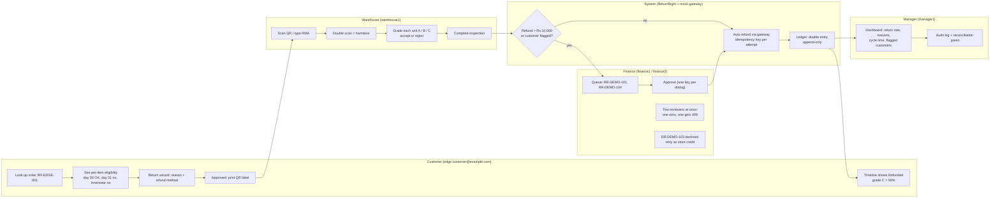
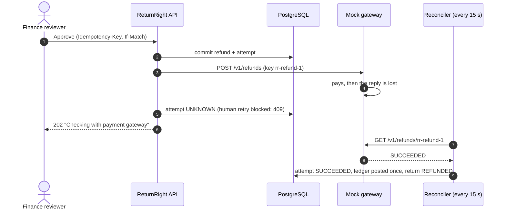

# ReturnRight — Demo Flow (one page)

> Written for: the person presenting the ~15-minute live demo. Exact clicks and expected screens are in
> [RUNBOOK.md](RUNBOOK.md). Logins: staff password = `RR_SEED_STAFF_PASSWORD` in your local `.env`.
> Re-seed before every run: `docker compose run --rm app --spring.profiles.active=seed --seed.as-of=<today> --seed.reset=true`

## 1. The story in one picture

## 2. Demo order and what each step proves

| # | Who | Do | Proves |
|---|---|---|---|
| 1 | Customer | Log in with `RR-EDGE-001` + `edge.customer@example.com`; open `RR-EDGE-002` and `RR-EDGE-008` | Eligibility engine: day 30 inclusive, day 31 rejected, innerwear blocked with a clear message [A-02][BR-1] |
| 2 | Customer | Return `RR-EDGE-001` (reason *Size/fit*), open the label | Atomic submit, label + QR, Idempotency-Key on submit [T1][T2] |
| 3 | Warehouse | `warehouse1` → Scan station → paste the QR token (or the RMA) twice | Receipt [T4]; second scan is a no-op [F-06] |
| 4 | Warehouse | Grade **C**, accept, Complete inspection | 50% half-up refund [BR-7]; under ₹10,000 → refunded automatically [T12][T15] |
| 5 | Customer | Refresh the return | Timeline ends *Refunded*; amounts per item |
| 6 | Finance | `finance1` → queue → `RR-DEMO-101` → Approve | Over ₹10,000 needs finance [A-12][T13] |
| 7 | Finance | `finance1` and `finance2` in two browsers approve `RR-DEMO-104` together | Exactly one wins; the other sees "updated by someone else" [F-04] |
| 8 | Finance | `RR-DEMO-103` (refund failed) → Retry → store credit | Definitive decline vs retry [T16][T17][A-17] |
| 9 | SRE + all | Customer returns laptop `RR-EDGE-009` → warehouse scans, grades A, completes (> ₹10,000 → finance queue). Run `infra/scripts/chaos.ps1 lost-responses`, finance approves, then `chaos.ps1 healthy` | Gateway paid but reply lost → *UNKNOWN* → reconciler → *Refunded*, **one** payout (ADR-001) |
| 10 | Manager | `manager1` → Dashboard, Flagged customers, Audit log, Reconciliation | Analytics, audit trail, ledger reconciles (R1–R5 = 0) |
| 11 | Anyone | pgAdmin → `ledger_entries` → try an `UPDATE` | Rejected: ledger is append-only [BR-19] |

## 3. Refund exactly-once (step 9) in one sequence

## 4. Where to look during the demo

| Screen | URL |
|---|---|
| App (all personas) | http://localhost:8080 |
| Grafana "ReturnRight — Operations" | http://localhost:3000 |
| Prometheus alerts | http://localhost:9090/alerts |
| pgAdmin | http://localhost:5050 |
| Swagger UI | http://localhost:8000/swagger-ui.html |
| Emails (profile `streaming` only) | http://localhost:8025 |
