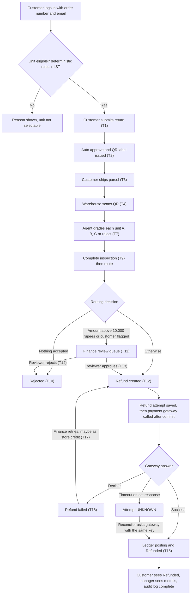

# ReturnRight: Ideation

Hackathon Track A (retail returns and refunds). This document explains why ReturnRight exists, who uses it, what we built, what we cut, and how we will judge ourselves in the demo.
Design detail lives in [`architecture/`](architecture), [`adr/`](adr), [`LLD.md`](LLD.md) and the step-by-step demo in [`RUNBOOK.md`](RUNBOOK.md). Tags such as `A-nn` (assumption), `T-nn` (transition), `F-nn` (failure mode) and `BR-nn` (database rule) point into `architecture/01-architecture-part1.md`.

## 1. Problem statement

Returns at a mid-size retailer run on email threads and spreadsheets. Three things go wrong, all of them expensive:

| Symptom | Root cause | Cost |
|---|---|---|
| Customers chase status ("where is my refund?") | No single status the customer can see; support answers from a spreadsheet | Support load, lost trust |
| The warehouse re-keys data | Return details travel by email; the agent retypes order, item and condition into another sheet | Errors, slow cycle time |
| Finance pays duplicate refunds | A refund is triggered by hand, twice by two people, or retried after a timeout nobody can see | Direct money loss, no audit trail |

The common thread: there is no single owner of the return's state, no memory of who did what, and no safe way to retry a payment whose outcome is unknown.

## 2. Personas

| Persona | Goals | Pain points today |
|---|---|---|
| **Customer** | Know in seconds whether an item can be returned, print a label, see where the refund is | Unclear policy (30 days from when? which timezone?), no status, no confirmation of refund |
| **Warehouse Agent** | Scan a parcel, grade each unit, move on | Re-typing data, ambiguous conditions, double scans causing noise, cancelled returns arriving anyway |
| **Finance Reviewer** | Approve large or suspicious refunds quickly, never pay twice | No queue, no idea if a gateway timeout means "paid" or "not paid", fear of double payment |
| **Operations Manager** | See return rate, reasons, cycle time, repeat returners; clear false flags | Numbers assembled by hand, no audit trail, flagged customers found by luck |
| **Admin** | Operate the platform and act for any staff role during the demo | Needs one login that can reach every staff screen |

## 3. Solution concept

ReturnRight is one portal with four role-specific views over a single return record.

- **Customer portal.** Log in with order number and email, see per-unit eligibility with a plain-language reason, submit a return, print a QR label, watch a timeline.
- **Warehouse scan station.** Scan the label QR (or type the RMA number), grade each unit A, B, C or reject, complete inspection. The system routes the return itself.
- **Finance queue.** Returns above ₹10,000 or from flagged customers wait here. Approve, reject, retry a declined refund (optionally as store credit), or recheck a refund whose outcome is unknown.
- **Manager dashboard.** Return rate by category, top reasons, cycle time, flagged customers, audit search, reconciliation status.

Every state change goes through one function (`ReturnStateMachine.apply`) that locks the row, checks the version and the role, writes the audit record and, when money is involved, creates the refund rows in the same database transaction.

### End-to-end flow

## 4. Key differentiators

| Differentiator | What it means | Where it is proven |
|---|---|---|
| **Refund exactly-once** (ADR-001) | Three layers: client `Idempotency-Key`, database uniqueness per return and per unit, and a per-attempt gateway key `rr-{refundId}-{attemptNo}`. Timeouts become `UNKNOWN`, never `FAILED`; only the reconciler or a recheck resolves them with the same key | Integration tests, Locust "approve storm" (0 duplicates), chaos demo |
| **One state machine, one audit trail** | Only `ReturnStateMachine.apply` may change a return or unit status; ArchUnit enforces it. Every change writes `audit_log` in the same transaction | `ArchitectureTest`, `TransitionTableTest`, audit search in the manager UI |
| **Business rules enforced by the database** | Triggers and constraints (BR-1 to BR-20) reject illegal transitions, ineligible units, double refunds and unbalanced ledger entries even if the app has a bug | Integration tests, pgAdmin demo |
| **Immutable double-entry ledger** | Ledger and audit rows cannot be updated or deleted by any role (trigger plus revoked grants). Corrections are reversal transactions | pgAdmin demo: `UPDATE ledger_entries` is rejected |
| **Deterministic eligibility in IST** | A pure engine; day 30 is eligible, day 31 is not, electronics 10/11, evaluated on `Asia/Kolkata` calendar dates [A-02] | Golden orders RR-EDGE-001 to 017 |
| **Fault-injectable gateway plus reconciler** | `chaos.ps1` switches the mock gateway between healthy, slow, flaky, lost-responses, blackhole, declines | Chaos demo in the runbook |
| **Observability** | `rr_*` Prometheus metrics, three alert rules, provisioned Grafana dashboard, correlation id on every response | Grafana and Prometheus during the demo |

## 5. Business rules summary

| Rule | Value | Tag |
|---|---|---|
| Return window | 30 calendar days from delivery (electronics 10), IST, inclusive of the last day | A-01, A-02, BR-1 |
| Not returnable | Innerwear, perishables, cancelled or undelivered orders | BR-1, BR-2 |
| Approval | Automatic when eligible | A-08 |
| Refund per unit | Grade A and B 100 percent, grade C 50 percent (half rounds up), rejected 0 | A-10, BR-7 |
| Finance review | Return total after grading strictly above ₹10,000.00, or the customer is flagged | A-12, A-13, BR-4 |
| Flag | More than 3 return requests (cancelled and rejected included) in a rolling 30 days; review only, cleared manually by the manager | A-14, A-15 |
| Label | Valid 14 days; expired labels cancel `APPROVED` returns | A-19 |
| Refund method | Customer picks; finance may switch to store credit only after a failure | A-16, A-17, A-22 |
| Money | Integer paise; shipping is not refunded | A-11 |
| Customer identity | Order number plus email, rate limited (10 failed lookups per order per hour) | A-24, A-29 |

## 6. MVP scope and cut list

**In the MVP (built and verified, see `HANDOFF.md`):** all 17 transitions, eligibility engine, QR labels, warehouse scan and inspection, finance queue with approve, reject, retry and recheck, refunds through the mock gateway, double-entry ledger with reconciliation R1, R2, R4 and R5, audit log and search, analytics dashboard, flagged customers, seeder with golden cases, Prometheus and Grafana, notifier (email through Kafka and Mailpit, optional profile), CI, Locust approve storm.

**Out of scope or cut:**

| Item | Status |
|---|---|
| Photo uploads (customer and inspection) [A-25] | Cut; UI hidden |
| Reconciliation R3 (ledger vs gateway list) | Not wired: `GatewayClient.listSucceeded()` exists but nothing calls it |
| Label-expiry job verification | Job exists, not verified end to end |
| Real carrier, courier tracking, real payment gateway | Out of scope; gateway is a mock |
| COD orders [A-23], currencies other than INR [A-28] | Out of scope |
| Mobile app | Out of scope |
| Splitting returns, refunds, ledger and audit into separate services | Rejected on purpose (ADR-002): their invariants need single-transaction atomicity |
| MockMvc API test level (RBAC matrix, idempotency replay) | Partly covered by `tests/e2e-api/scenario.py`; not yet in `mvnw verify` |

## 7. Demo success metrics

| Metric | Target | How to show it |
|---|---|---|
| Duplicate refunds under faults | 0 | Lost-response chaos run: one gateway payout per refund; reconciliation card all green |
| Reconciliation R1, R2, R4, R5 mismatches | 0 after every run | Manager reconciliation page, Grafana panel |
| Eligibility boundaries | Day 30 OK, day 31 rejected, electronics 10/11 | RR-EDGE-001, 002, 003, 004 |
| Time from last scan to refund (auto path) | Seconds | Warehouse completes inspection, customer timeline shows Refunded |
| Self-healing of an UNKNOWN refund | Settled within about 15 to 30 seconds | Chaos demo (reconciler runs every 15 s) |
| Two reviewers racing | Exactly one wins, the other sees "updated by someone else" (409) | Two browsers |
| Automated test results | Backend 76/76, gateway 8/8, notifier 20/20, API scenario 24/24, Playwright 13/13 (as recorded in `HANDOFF.md`) | `RUNBOOK.md` section on tests |

## 8. Risks and mitigations

| Risk | Mitigation |
|---|---|
| Double payment in the demo (K1) | Three-layer idempotency, DB constraints as the backstop, fault-injection tests, Locust storm |
| Timezone and boundary bugs (K2) | Pure engine, injected `Clock`, boundary unit tests, DB trigger mirrors the engine, golden seed orders |
| Windows and Docker friction (K3) | LF line endings, Postgres on host port 5434, every Java suite can run in a container |
| Bleeding-edge versions (K4) | Exact versions pinned (see `LLD.md` section 14) |
| Demo data consumed during a run | Re-seed with `--seed.reset=true` between runs; it also clears rate limits |
| Team branches diverged (`dev` uses Spring Boot 3.5.6) | Decision pending; `HANDOFF.md` item 6. This branch is the complete one |
| First CI run not yet observed on GitHub | Watch the first run (`HANDOFF.md` item 1) |
| Open product decision on lookup limit | Resolved by A-29 (failed lookups only) |

## 9. Future roadmap

1. **Mobile and PWA.** Camera scanning is already in the warehouse screen where the browser supports it; a PWA would make the scan station and customer portal installable.
2. **Photo uploads** for damaged or defective items and for inspection evidence [A-25].
3. **Reconciliation R3.** Three-way check of ledger against the gateway's own list of succeeded refunds; would catch a double payment on the gateway side.
4. **Real integrations.** Carrier pickup and tracking, a real payment provider behind `GatewayClient`, real email provider behind the notifier.
5. **Ops reinstate** of a cancelled return whose parcel arrives anyway (F-16).
6. **Store credit redemption** at checkout (a debit on `STORE_CREDIT_LIABILITY`).
7. **Alertmanager** and paging, once there is more than one laptop.
