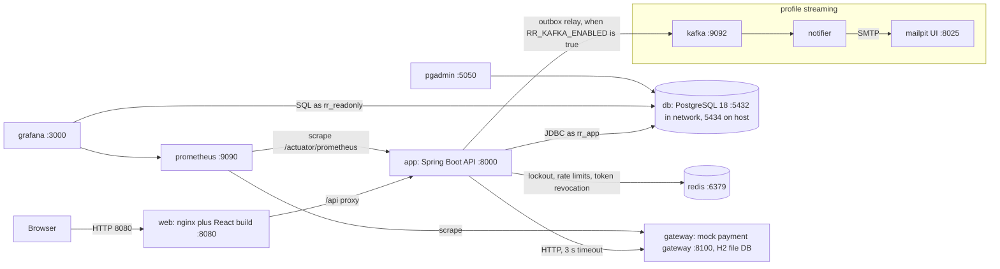
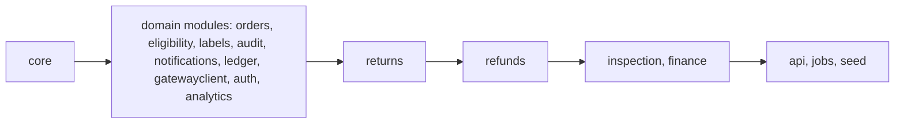
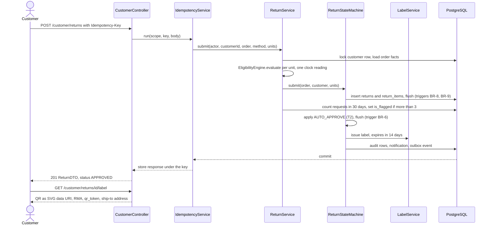
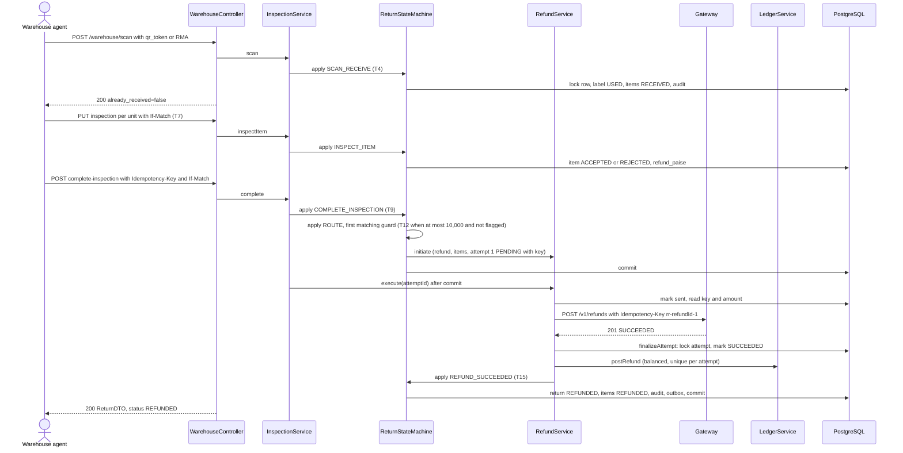
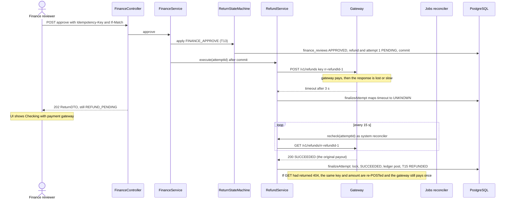
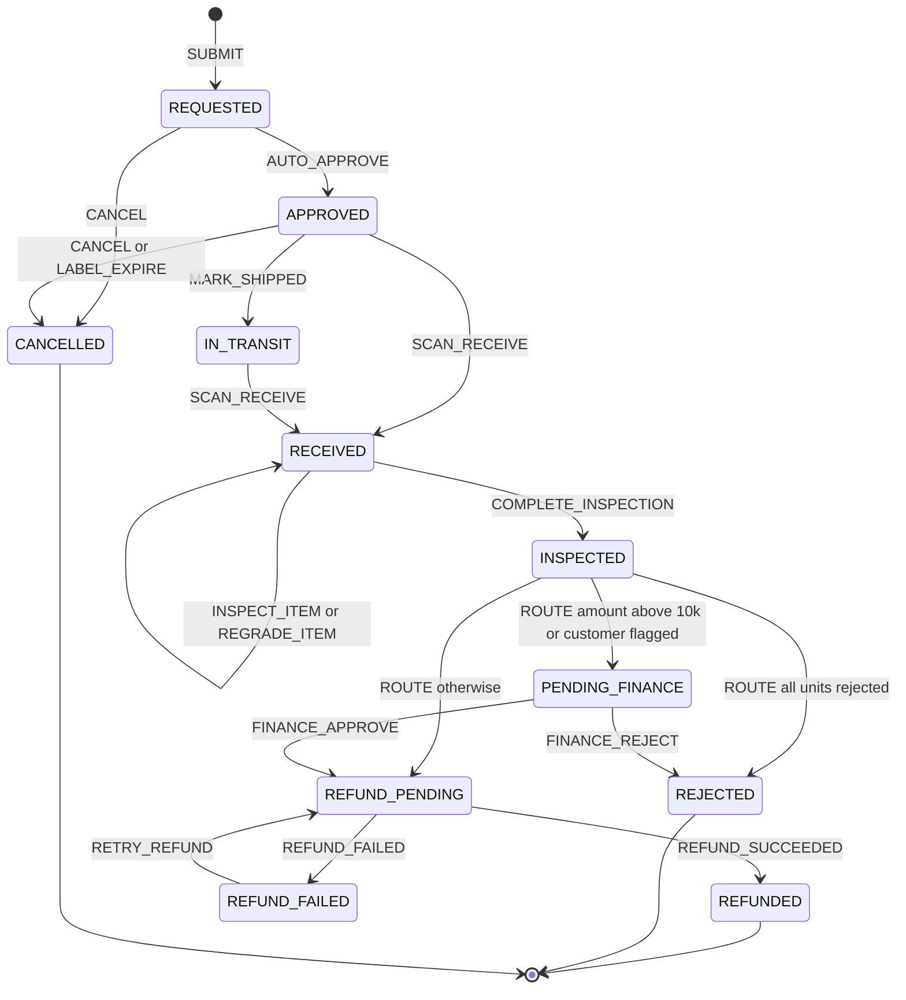

# ReturnRight: Low-Level Design

Audience: the team, judges and new teammates. This is the implementation view of the design in [`architecture/01-architecture-part1.md`](architecture/01-architecture-part1.md) and [`architecture/02-architecture-part2.md`](architecture/02-architecture-part2.md). If this file and the API contract differ, [`api/contract.md`](api/contract.md) wins. Rules for contributors are in [`../CLAUDE.md`](../CLAUDE.md); status and traps are in [`HANDOFF.md`](HANDOFF.md).

Tags: `A-nn` assumption, `T-nn` transition, `F-nn` failure mode, `BR-nn` database rule (all in Part 1).

## 1. System overview

ReturnRight is a modular monolith (Spring Boot API) with two separate services where the boundary is natural: a mock payment gateway and a notifier. Returns, refunds, ledger and audit stay in one process and one PostgreSQL database because their invariants depend on single-transaction atomicity (ADR-002).

Principles that shape every class below:

1. One writer of return status: `ReturnStateMachine.apply`.
2. Database effects in one transaction; external calls (gateway) only after commit.
3. The refund attempt row (with its gateway key) is committed before the gateway is called; an ambiguous outcome is `UNKNOWN`, never `FAILED`.
4. Ledger and audit are append-only; money is a `long` of paise.
5. No `Instant.now()` in domain code; an injected `java.time.Clock`.

## 2. Containers



| Service | Image or build | Host port | Role |
|---|---|---|---|
| `web` | `./frontend` (node 26 build, `nginx:1.29-alpine`) | 8080 | Serves the SPA, proxies `/api` to `app` |
| `app` | `./backend` (Temurin 21) | 8000 | API, jobs, seeder (`--spring.profiles.active=seed`) |
| `gateway` | `./gateway` (Temurin 21) | 8100 | Mock payment gateway with fault injection, own H2 store (volume `gatewaydata`) |
| `db` | `postgres:18` | 5434 (container 5432) | System of record; roles created once from `infra/postgres/init` |
| `redis` | `redis:8-alpine` | 6379 | Login lockout, rate limits, JWT revocation. Not on the money path; the app falls back to in-memory counters |
| `pgadmin` | `dpage/pgadmin4:9` | 5050 | Browse data; servers preconfigured (read-only and owner) |
| `prometheus` | `prom/prometheus:v3.7.3` | 9090 | Scrapes `app` and `gateway`; alert rules from `infra/prometheus/alerts.yml` |
| `grafana` | `grafana/grafana:12.3.0` | 3000 | Provisioned dashboard "ReturnRight - Operations" |
| `kafka` | `apache/kafka:4.1.0` (KRaft, single node) | none | Profile `streaming`; topic `returnright.events` |
| `notifier` | `./notifier` | none | Profile `streaming`; consumes events, sends email |
| `mailpit` | `axllent/mailpit:v1.27` | 8025 | Profile `streaming`; catches SMTP |

The compose project name is `returnright`. Kafka is optional by design: the outbox row is written in the state-change transaction; with `RR_KAFKA_ENABLED=false` events simply stay unpublished.

## 3. Backend package structure

Root package `com.returnright` under `backend/src/main/java/`:

```
ReturnRightApplication.java
api/
  controller/   AuthController CustomerController WarehouseController FinanceController ManagerController HealthController
  dto/request/  CustomerLookupRequest StaffLoginRequest SubmitReturnRequest SubmitItem InspectionRequest
                NoteRequest RequiredNoteRequest RetryRequest ScanRequest
  dto/response/ ReturnDto ItemDto RefundDto AttemptDto LabelDto LabelSummary Eligibility OrderDetail OrderSummary
                UnitDto CustomerSummary ScanResponse TimelineEntry ListResponse
  mapper/       ReturnViewAssembler
  security/     SecurityConfig
  support/      RequestSupport
core/
  config/       AppClock CoreConfig RrProperties
  enums/        ReturnStatus ReturnEvent ItemStatus Role Grade Decision RefundMethod RefundStatus AttemptStatus ... (21 enums)
  exception/    ApiException GlobalExceptionHandler
  infra/        IdempotencyService KvStore Metrics OutboxService
  model/        Actor
  util/         Json Money
  web/          Correlation CorrelationIdFilter
orders/         entity {Customer Order OrderItem Product Category}  repository
eligibility/    EligibilityEngine EligibilityMessages            (JDK only, no Spring)
labels/         entity {ReturnLabel}  repository  service {LabelService}
audit/          service {AuditService}
notifications/  service {NotificationService}
ledger/         service {LedgerService}
gatewayclient/  GatewayClient
auth/           config {JwtConfig}  entity {User}  repository  service {AuthService}
analytics/      service {AnalyticsService}
returns/        entity {ReturnRequest ReturnItem}  repository  service {ReturnService ReturnStateMachine}
refunds/        entity {Refund RefundAttempt}  repository  service {RefundService}
inspection/     service {InspectionService}
finance/        service {FinanceService}
jobs/           Jobs OutboxRelay
seed/           Seeder Catalogue
```

Resources: `application.yml`, `application-seed.yml`, `db/migration/V1..V4`.

### 3.1 Layering rules (enforced by `ArchitectureTest`)



Arrows mean "may be used by". A module may only depend on layers to its left.

| Test in `ArchitectureTest` | Rule |
|---|---|
| `modulesRespectTheLayering` | Layers Core, Domain, Returns, Refunds, Workflows (`inspection`, `finance`), Entry (`api`, `jobs`, `seed`); nothing may access Entry; Workflows only from Entry; Refunds only from Workflows and Entry; Returns only from Refunds, Workflows, Entry; Domain only from Returns and above |
| `coreDependsOnNoOtherModule` | `core` imports no other module |
| `eligibilityIsPureJava` | `eligibility` depends only on `java..` and itself |
| `noCyclesBetweenModules` | Slices `com.returnright.(*)..` are cycle free |
| `controllersLiveOnlyInTheApiLayer` | `@RestController` classes live in `api.controller` |
| `controllersNeverUseRepositories` | Controllers do not depend on any `..repository..` package |
| `repositoriesAreOnlyUsedByServicesMappersJobsAndTheSeeder` | Repositories are accessed only from `..service..`, `..repository..`, `jobs`, `seed`, `api.mapper` |
| `entitiesDoNotDependOnServicesOrTheApi` | Entities never depend on services or `api` |
| `dtosDoNotExposeEntities` | `api.dto` never depends on an entity |
| `onlyTheStateMachineMutatesReturnsAndReturnItems` | Only `ReturnStateMachine` (and the entities themselves) may call `setStatus`, `bumpVersion`, `setClosedAt`, `setApprovedRefundPaise`, `setOutcome`, `setFinanceReview`, `setCancelReason`, `setRefundMethod`, `inspect` on `ReturnRequest` or `ReturnItem` |

### 3.2 Module responsibilities

| Module | Key classes | Responsibility |
|---|---|---|
| `core` | `Actor`, `ApiException`, `GlobalExceptionHandler`, `IdempotencyService`, `KvStore`, `Metrics`, `OutboxService`, `Money`, `RrProperties`, `AppClock`, `CorrelationIdFilter` | Shared kernel: error envelope, clock, typed configuration, HTTP idempotency, Redis-backed counters, metrics facade, outbox writer, enums |
| `orders` | `Order`, `OrderItem`, `Customer`, `Product`, `Category` and repositories | Read-mostly catalogue and order data |
| `eligibility` | `EligibilityEngine`, `EligibilityMessages` | Pure rule engine R1 to R7; the only source of customer-facing eligibility text |
| `labels` | `LabelService`, `ReturnLabel` | Issue, void and use QR labels (ZXing renders the SVG), 14-day expiry |
| `audit` | `AuditService` | `record(...)` with `Propagation.MANDATORY`: never opens or commits its own transaction |
| `notifications` | `NotificationService` | In-app notification rows [A-26] |
| `ledger` | `LedgerService` | Append-only double-entry posting, reversal, reconciliation checks |
| `gatewayclient` | `GatewayClient` | HTTP to the gateway; maps every ambiguity to `UNKNOWN` |
| `auth` | `AuthService`, `JwtConfig`, `User` | Customer lookup, staff login, lockout, rate limit, logout revocation |
| `analytics` | `AnalyticsService` | Native SQL for KPIs, return rate, reasons, cycle time, daily series |
| `returns` | `ReturnStateMachine`, `ReturnService`, `ReturnRequest`, `ReturnItem` | Customer workflow and THE transition function |
| `refunds` | `RefundService`, `Refund`, `RefundAttempt` | ADR-001 execution: initiate, execute, finalize, recheck, retry |
| `inspection` | `InspectionService` | Warehouse scan, inspect, complete and route |
| `finance` | `FinanceService` | Approve, reject, retry, recheck |
| `api` | Controllers, DTO records, `ReturnViewAssembler`, `SecurityConfig`, `RequestSupport` | HTTP only: validate, call a service, map to a DTO |
| `jobs` | `Jobs`, `OutboxRelay` | Scheduled reconciler, label expiry, outbox relay, idempotency purge, gauges |
| `seed` | `Seeder`, `Catalogue` | Deterministic synthetic data, driven through the services |

## 4. Key classes in depth

### 4.1 `ReturnStateMachine` (`returns.service`)

The single place where a return or return item changes state (Part 1 §4.5).

- **Transition table is data.** `defineTable()` registers `(from status, event) -> list of Transition(to, roles, guard)`. For `ROUTE` the first candidate whose predicate holds wins (T10, then T11, then T12). `allowedPairs()` exposes the status pairs; `TransitionTableTest` and the `TransitionTableTest` mentioned in V2 compare them with the SQL trigger `trg_returns_valid_transition` [BR-6].
- **`apply(returnId, event, actor, expectedVersion, payload)`** runs in the caller's transaction. Order of checks: row lock (`PESSIMISTIC_WRITE`) then ownership (a miss is `404`, never `403`) then `If-Match` version (`409 STALE_VERSION`) then transition exists (`409 ILLEGAL_TRANSITION`, details carry current state and event) then role (`403 FORBIDDEN_ROLE`) then guards (`422`). ADMIN may act for any staff role, not for customers or the system.
- **Per-step flush.** `em.flush()` after every transition so the database trigger sees each step; chained steps such as T1 then T2, or T9 then ROUTE, therefore each pass the trigger [BR-4][BR-6].
- **Effects in the same transaction:** items, labels, refund rows (through `RefundService.initiate`), ledger (through `RefundService`), audit (`AuditService.record`), notifications, outbox event, metrics counters. Anything external is registered as an after-commit synchronization.
- **`submit(...)`** is the only place a return is born (T1) followed immediately by AUTO_APPROVE (T2) and label issue.
- **Routing guard** (`financeReason`): total strictly above `rr.finance-threshold-paise` (1,000,000) or customer flagged, read live at routing time [A-12][A-13][F-14].
- `hasTransition(status, event)` feeds `allowed_actions` in the DTO so the UI shows only valid buttons.

### 4.2 `ReturnService` (`returns.service`)

- `units(order, now)` gathers eligibility facts for every physical unit in one query (active or past returns per unit) and runs the pure engine for each. Returns `UnitView` records for the order-detail screen.
- `submit(actor, customerId, orderNumber, method, units)`: locks the customer row (so concurrent submits count correctly, F-14), takes one `clock.instant()` reading used for both eligibility and `returns.created_at` (F-12), re-validates every unit; if any unit fails, the whole request is rejected with per-item reasons (`422 ITEM_NOT_ELIGIBLE`, [A-06]); then applies the **flag rule**: more than `rr.flag-threshold` (3) return requests, cancelled and rejected included, in a rolling `rr.flag-window-days` (30) flags the customer [A-14]. Review only; routing decides later. A duplicate unit is also stopped by `uq_return_items_active_unit` [BR-8, F-15].
- `ship` (T3), `cancel` (T5), `clearFlag` (manager, mandatory note, audited [A-15]).

### 4.3 `RefundService` (`refunds.service`)

Implements ADR-001.

| Method | Behaviour |
|---|---|
| `initiate(return, actor)` | In the caller's transaction (T12 or T13): create `refunds`, one `refund_items` row per unit, and `refund_attempts` #1 `PENDING` with `gateway_idempotency_key = rr-{refundId}-{attemptNo}`. Store credit completes inline (attempt `SUCCEEDED`, ledger, T15 in the same transaction, F-20) and returns empty. Otherwise returns the attempt id to execute after commit |
| `execute(attemptId)` | Called after commit and refuses to run inside a transaction. A short transaction marks the attempt sent and reads key, payment reference and the frozen amount; the gateway call happens outside any transaction; then `finalizeAttempt` |
| `finalizeAttempt(attemptId, outcome, actor)` | Locks the attempt (`findForUpdate`). If already terminal, returns its status (no-op, F-09). `SUCCEEDED`: mark attempt and refund, `LedgerService.postRefund`, audit, then `REFUND_SUCCEEDED` (T15). `FAILED` (explicit gateway decline only): mark failed, `REFUND_FAILED` (T16). `PROCESSING`, `UNKNOWN`, `NOT_FOUND`: attempt `UNKNOWN` (once), return stays `REFUND_PENDING` |
| `recheck(attemptId, actor)` | `GET` the gateway by key; if `NOT_FOUND` the gateway never saw it, so re-POST with the **same key and amount** (F-02, F-07); then `finalizeAttempt`. Used by the reconciler and by finance "Recheck" |
| `retry(returnId, actor, version, switchTo)` | T17, only when no attempt is `PENDING`, `UNKNOWN` or `SUCCEEDED` (also database enforced, `uq_refund_one_live_attempt`, [BR-15]); new attempt `attempt_no + 1`, new key; optional switch to store credit [A-17] |
| `reconcileCandidates(staleBefore)` | `UNKNOWN` attempts and `PENDING` attempts older than `rr.jobs.stale-pending-seconds` (60) |

Recheck by finance is applied as `Actor.system("recheck")` because T15 and T16 are SYSTEM-only; the reviewer is recorded as `RECHECK_REQUESTED` in the audit log (fixed bug, see `HANDOFF.md`).

### 4.4 `LedgerService` (`ledger.service`)

- Only writer of `ledger_transactions` and `ledger_entries` (plain JDBC `JdbcTemplate`; no update path exists).
- `refundLines(RefundPosting)` is a pure function (unit-tested): per accepted unit a `SALES_RETURNS` debit of the gross price; for grade C a `RETURN_CONDITION_RECOVERY` credit of the deduction; one final credit to `GATEWAY_SETTLEMENT` (original payment) or `STORE_CREDIT_LIABILITY` with `customer_id` (store credit). Rejected units get no lines (Part 1 §7.3).
- `postRefund` runs only on `SUCCEEDED`, once per attempt (`refund_attempt_id` UNIQUE, [BR-16]).
- `reverse(transactionId, reason, actorId)` posts a mirror transaction with directions swapped; a transaction can be reversed once [BR-17].
- `storeCreditBalance(customerId)` = credits minus debits on `STORE_CREDIT_LIABILITY`.
- `reconcile(staleMinutes)` returns the checks that are implemented: R1 refund and ledger, R2 items and ledger, R4 global balance, R5 stuck attempts. R3 (against the gateway list) is not wired.

### 4.5 `IdempotencyService` (`core.infra`)

HTTP-level layer L1 of ADR-001. `run(scope, key, requestBody, route, ...)`: same key and same body replays the stored response; same key with a different body is `422 IDEMPOTENCY_KEY_REUSED`; same key still running is `409 REQUEST_IN_PROGRESS`. A failed call (`ApiException`) releases the key so the client can correct and retry. Safety does not rest on this layer alone: the state machine (L2) and DB constraints (L3) still guard. `Jobs.purgeIdempotencyKeys` cleans old keys hourly.

### 4.6 `AuthService` (`auth.service`)

- **Tokens:** JWT HS256 (Spring Security resource server with Nimbus), secret from `RR_JWT_SECRET`; customer TTL 60 min, staff 480 min.
- **Passwords:** argon2id (`Argon2PasswordEncoder`, needs BouncyCastle).
- **Customer lookup** (order number plus email, case-insensitive): per-IP limit 5 per minute counts every attempt; per-order limit of 10 **failed** lookups per hour counts failures only [A-29]; a mismatch always returns the same generic `404`; limits return `429 RATE_LIMITED` with `retry_after_seconds` and a message naming the real window.
- **Staff login:** 5 failures lock the account for 900 s (`423 ACCOUNT_LOCKED`), per-IP limit 30 per minute; `logout` revokes the token server side (Redis).
- `actorFrom(jwt)` builds the domain `Actor` from a validated token.

### 4.7 `InspectionService` (`inspection.service`)

- `scan(actor, tokenOrRma)`: resolves a QR token or RMA number; T4 on `APPROVED` or `IN_TRANSIT`. A repeat scan on `RECEIVED` or later returns `already_received=true` with no transition and no audit row (F-06). A scan on a cancelled return gives `409 RETURN_CANCELLED` (F-05).
- `inspectItem(...)`: T7 or T8 (grade A, B, C or reject; C = `(price + 1) / 2`).
- `complete(actor, returnId, version)`: T9 then ROUTE (T10, T11 or T12) in one transaction; an auto-refund executes after commit.

### 4.8 `FinanceService` (`finance.service`)

`approve` (T13, writes `finance_reviews`), `reject` (T14, reason required), `retry` (T17), `recheck(attemptId)`. It locks first and validates afterwards, so two reviewers serialise and the loser receives a clean `409` (F-04); `finance_reviews.return_id UNIQUE` is the final backstop [BR-10].

### 4.9 `EligibilityEngine` (`eligibility`)

Pure and static: `evaluate(UnitFacts, Instant now, ZoneId tz)`. Rule order, first failure wins:

| Rule | Reason code |
|---|---|
| R1 order cancelled | `ORDER_CANCELLED` |
| R2 order not delivered or no delivery date | `ORDER_NOT_DELIVERED` |
| R3 delivery date in the future | `DELIVERY_DATE_INVALID` |
| R4 category not returnable | `CATEGORY_NOT_RETURNABLE` |
| R5 unit already returned | `UNIT_ALREADY_RETURNED` |
| R6 unit in an active return | `UNIT_RETURN_IN_PROGRESS` |
| R7 `days_since_delivery > window_days` | `RETURN_WINDOW_EXPIRED` |
| otherwise | `ELIGIBLE` |

Days are IST calendar dates: `today_local - delivered_local`; day 0 is the delivery day, last eligible day is inclusive [A-02]. `RULE_VERSION = "2026-11-v1"`. Customer text comes only from `EligibilityMessages`. The database trigger `trg_return_item_eligibility` mirrors the engine [BR-9].

### 4.10 `GatewayClient` (`gatewayclient`)

`createRefund(key, paymentReference, amountPaise, merchantRef)`, `getRefund(key)`, `listSucceeded()` (for R3, unused), `healthy()`. Timeout `rr.gateway.timeout-ms` (3000). Timeout, 5xx, connection error and malformed body map to `Status.UNKNOWN`; only an explicit `status: FAILED` is `FAILED`; HTTP 404 on GET is `NOT_FOUND`. Records `rr.gateway.request.duration`.

### 4.11 `Jobs` and `OutboxRelay` (`jobs`)

Each run takes a Postgres advisory lock (`pg_try_advisory_lock`) so only one instance executes. Disabled with `rr.jobs.enabled=false`.

| Job | Schedule | Action |
|---|---|---|
| `reconcileRefunds` (lock 7001) | every 15 s (initial delay 10 s) | `recheck` up to 25 candidates (`UNKNOWN` or stale `PENDING`) as `Actor.system("reconciler")` |
| `expireLabels` (lock 7002) | every 5 min | `LABEL_EXPIRE` (T6) for `APPROVED` returns with an expired active label [A-19]. Not verified end to end |
| `relayOutbox` (lock 7003) | every 2 s | `OutboxRelay.relayBatch`: publish `outbox_events` to Kafka at least once, key = return id; only when `RR_KAFKA_ENABLED=true` |
| `purgeIdempotencyKeys` | hourly | delete old keys |
| `refreshGauges` | every 10 s | `rr_returns_open{status}`, `rr_refund_attempts_unknown`, `rr_refund_attempts_unknown_oldest_age_seconds`, `rr_customers_flagged`, `rr_reconciliation_mismatches{check}` |

### 4.12 `Seeder` (`seed`)

Runs with `--spring.profiles.active=seed --seed.as-of=YYYY-MM-DD --seed.reset=true`. Deterministic (fixed Datafaker random seed `20261120`), creates the six staff users, five named customers, 500 generated customers, the catalogue (40 products, 6 categories), about 2,030 orders, golden orders (`RR-EDGE-*`, `RR-FLAG-*`, `RR-DEMO-*`) and about 230 historical returns, all driven through `ReturnStateMachine` and the services, never raw status writes (F-13). `--seed.reset` also clears `rl:*`, `fail:*` and `lock:*` keys in Redis. At the end it prints reconciliation R1 to R5. Details in [`demo-data.md`](demo-data.md).

## 5. Sequence diagrams

### 5.1 Customer submits a return and gets a label (T1, T2)



### 5.2 Warehouse scan, inspect, complete, route, auto refund (T4, T7, T9, T12, T15)



### 5.3 Finance approves, gateway times out, UNKNOWN, reconciler, REFUNDED (T13, F-02, F-03)



## 6. Return state machine

States and events (Part 1 §4). `INSPECTED` is persisted and audited but `ROUTE` fires in the same transaction, so no return rests there.



Roles: C customer, W warehouse, F finance, M ops manager, S system.

| # | From | Event | To | Role | Main guard or effect |
|---|---|---|---|---|---|
| T1 | none | `SUBMIT` | `REQUESTED` | C | All units eligible; at least one unit; units not already in a return; flag rule evaluated |
| T2 | `REQUESTED` | `AUTO_APPROVE` | `APPROVED` | S | Same transaction as T1; issues label (valid 14 days) |
| T3 | `APPROVED` | `MARK_SHIPPED` | `IN_TRANSIT` | C | Label active and not expired |
| T4 | `APPROVED`, `IN_TRANSIT` | `SCAN_RECEIVE` | `RECEIVED` | W | QR resolves; label active; label to `USED`; repeat scan is a no-op (F-06) |
| T5 | `REQUESTED`, `APPROVED` | `CANCEL` | `CANCELLED` | C, M | Not yet scanned; label voided; units freed |
| T6 | `APPROVED` | `LABEL_EXPIRE` | `CANCELLED` | S | Label expired |
| T7 | `RECEIVED` | `INSPECT_ITEM` | `RECEIVED` | W | ACCEPT needs grade, REJECT needs reason; computes `refund_paise` |
| T8 | `RECEIVED` | `REGRADE_ITEM` | `RECEIVED` | W | Recompute `refund_paise` |
| T9 | `RECEIVED` | `COMPLETE_INSPECTION` | `INSPECTED` | W | No unit left in `RECEIVED`; sets `approved_refund_paise`, outcome FULL, PARTIAL or NONE; then ROUTE |
| T10 | `INSPECTED` | `ROUTE` | `REJECTED` | S | `approved_refund_paise = 0` |
| T11 | `INSPECTED` | `ROUTE` | `PENDING_FINANCE` | S | Amount above 1,000,000 paise or customer flagged (read live) |
| T12 | `INSPECTED` | `ROUTE` | `REFUND_PENDING` | S | Otherwise; `RefundService.initiate`; gateway call after commit |
| T13 | `PENDING_FINANCE` | `FINANCE_APPROVE` | `REFUND_PENDING` | F | `Idempotency-Key`, `If-Match`; one finance review per return |
| T14 | `PENDING_FINANCE` | `FINANCE_REJECT` | `REJECTED` | F | Reason required; accepted units to `REJECTED` |
| T15 | `REFUND_PENDING` | `REFUND_SUCCEEDED` | `REFUNDED` | S | Attempt `SUCCEEDED`; ledger posting; units `REFUNDED` |
| T16 | `REFUND_PENDING` | `REFUND_FAILED` | `REFUND_FAILED` | S | Definitive gateway decline |
| T17 | `REFUND_FAILED` | `RETRY_REFUND` | `REFUND_PENDING` | F | No live attempt; optional switch to store credit |

An attempt becoming `UNKNOWN` is not a transition: the return stays `REFUND_PENDING`. Illegal pair: `409 ILLEGAL_TRANSITION`. Version mismatch: `409 STALE_VERSION`. The database trigger `trg_returns_valid_transition` (V2) holds the same 15 distinct status pairs as a safety net [BR-6].

## 7. Data model

### 7.1 Tables (`V1__schema.sql`)

| Table | Purpose | Notable DB-enforced rules |
|---|---|---|
| `categories`, `products` | Catalogue; category carries `returnable` and `window_days` | `ck_categories_window` [BR-1] |
| `customers` | Identity by email; `is_flagged` | |
| `orders`, `order_items` | Orders and priced lines (paise); delivery date | `ck_orders_delivered` [BR-2] |
| `users` | Staff accounts with argon2id hash and role | |
| `returns` | Return header: status, version, amounts, finance review fields, `created_at` from the app clock | `ck_returns_amount_after_inspection` [BR-3], `ck_returns_finance_threshold` and `trg_finance_approval_required` [BR-4], `trg_returns_valid_transition` [BR-6] |
| `return_items` | One row per physical unit: status, grade, decision, `refund_paise` | `ck_ri_grade_refund` [BR-7], `uq_return_items_active_unit` [BR-8], `trg_return_item_eligibility` [BR-9] |
| `return_labels` | QR label per return, status, expiry | |
| `finance_reviews` | One decision per return | `return_id` UNIQUE [BR-10] |
| `refunds` | One per return, frozen `amount_paise` | `return_id` UNIQUE [BR-11] |
| `refund_items` | One per refunded unit | `return_item_id` UNIQUE [BR-12]; sum equals refund amount, deferred trigger [BR-13] |
| `refund_attempts` | Attempts with `gateway_idempotency_key` and status | Key UNIQUE [BR-14]; `uq_refund_one_live_attempt` allows at most one `PENDING`, `UNKNOWN` or `SUCCEEDED` [BR-15] |
| `ledger_accounts` | Fixed chart of accounts | Not writable by `rr_app` |
| `ledger_transactions`, `ledger_entries` | Append-only double entry | UNIQUE `refund_attempt_id` [BR-16], UNIQUE `reverses_transaction_id` [BR-17], `trg_ledger_balanced` deferred [BR-18], immutability triggers [BR-19] |
| `audit_log` | Append-only audit of every state change | `trg_audit_log_immutable` [BR-20] |
| `notifications` | In-app notifications | |
| `idempotency_keys` | HTTP idempotency store (L1) | |
| `outbox_events` | Transactional outbox for Kafka | |

BR-5 (flag rule) is intentionally in the application, supported by an index on `returns(customer_id, created_at)`.

### 7.2 Flyway migrations (`backend/src/main/resources/db/migration`)

| File | Content |
|---|---|
| `V1__schema.sql` | All tables, constraints and indexes |
| `V2__business_rules.sql` | Triggers: valid transitions, finance approval, return-item eligibility, refund item sum, ledger balance, immutability of ledger and audit |
| `V3__grants.sql` | Least-privilege grants: `rr_app` DML only, `UPDATE`/`DELETE`/`TRUNCATE` revoked on ledger and audit tables; `rr_readonly` SELECT only |
| `V4__fix_deferred_trigger_functions.sql` | Fixes the PL/pgSQL functions behind the deferred triggers (a `CASE` read `NEW.<col>` from both branches) [BR-13][BR-18] |

Flyway runs as `rr_owner`; the app runs as `rr_app`. Hibernate is `ddl-auto=validate`. Never edit an applied migration.

## 8. API summary

Base path `/api/v1`, JSON in snake_case, money in paise. Shapes are in [`api/contract.md`](api/contract.md); Swagger UI is at `http://localhost:8000/swagger-ui.html`.

| Persona (role) | Endpoints |
|---|---|
| Public | `POST /auth/customer/lookup`, `POST /auth/staff/login` |
| Any signed-in | `GET /auth/me`, `POST /auth/logout` |
| Customer | `GET /customer/orders`, `GET /customer/orders/{orderNumber}`, `POST /customer/returns`, `GET /customer/returns`, `GET /customer/returns/{id}`, `GET /customer/returns/{id}/label`, `POST /customer/returns/{id}/ship`, `POST /customer/returns/{id}/cancel`, `GET /customer/notifications`, `POST /customer/notifications/read` |
| Warehouse | `POST /warehouse/scan`, `GET /warehouse/returns`, `GET /warehouse/returns/{id}`, `PUT /warehouse/returns/{id}/items/{itemId}/inspection`, `POST /warehouse/returns/{id}/complete-inspection` |
| Finance | `GET /finance/queue`, `GET /finance/returns/{id}`, `POST /finance/returns/{id}/approve`, `POST /finance/returns/{id}/reject`, `POST /finance/returns/{id}/refund/retry`, `POST /finance/refund-attempts/{attemptId}/recheck` |
| Manager | `GET /analytics/overview`, `GET /analytics/flagged-customers` (also finance), `POST /ops/customers/{id}/clear-flag`, `POST /ops/returns/{id}/cancel`, `GET /ops/audit` and `GET /ops/reconciliation` (also finance) |
| Platform (outside `/api/v1`) | `GET /healthz`, `GET /readyz`, `/actuator/prometheus`, `/v3/api-docs` |

**Headers**

| Header | Use |
|---|---|
| `Authorization: Bearer <token>` | All authenticated calls |
| `Idempotency-Key: <uuid>` | Required on submit, approve, reject, retry, complete-inspection, clear-flag. One key per dialog or form submission, not per click |
| `If-Match: "<version>"` | Required on human mutations of a return; version from `ReturnDTO.version` |
| `X-Correlation-ID` | Echoed on every response; also in logs (`cid:`) and the error envelope; the UI shows it as "Ref" |

**Error envelope** (every non-2xx): `{"error":{"code","message","details","correlation_id"}}`. Never a stack trace. Notable codes: `UNAUTHENTICATED` 401, `FORBIDDEN_ROLE` 403, `NOT_FOUND` 404, `ILLEGAL_TRANSITION` 409, `STALE_VERSION` 409, `REQUEST_IN_PROGRESS` 409, `UNIT_ALREADY_IN_RETURN` 409, `RETURN_CANCELLED` 409, `VALIDATION_ERROR` 422, `ITEM_NOT_ELIGIBLE` 422, `IDEMPOTENCY_KEY_REUSED` 422, `RATE_LIMITED` 429, `ACCOUNT_LOCKED` 423. Approve and retry answer `202` when the refund outcome is not final.

## 9. Security and RBAC

| Route prefix | Allowed roles (`SecurityConfig`) |
|---|---|
| `/healthz`, `/readyz`, `/actuator/prometheus`, `/v3/api-docs`, `/swagger-ui` | anyone |
| `POST /auth/customer/lookup`, `POST /auth/staff/login` | anyone |
| `/auth/**` (others) | any authenticated |
| `/customer/**` | `CUSTOMER` |
| `/warehouse/**` | `WAREHOUSE_AGENT`, `ADMIN` |
| `/finance/**` | `FINANCE_REVIEWER`, `ADMIN` |
| `/analytics/flagged-customers`, `/ops/audit`, `/ops/reconciliation` | `OPS_MANAGER`, `FINANCE_REVIEWER`, `ADMIN` |
| `/analytics/**`, `/ops/**` (others) | `OPS_MANAGER`, `ADMIN` |

- **Defense in depth:** the route guard is the first line; the state machine re-checks the role per transition (a warehouse agent cannot approve a refund even if a route were misconfigured). The manager cannot approve refunds (separation of duties).
- **Ownership:** every customer query is scoped to the token's customer id; another customer's return is `404`, never `403`.
- **Tokens:** HS256 JWT, kept in `sessionStorage` by the SPA (a documented hackathon trade-off; an httpOnly cookie would need CSRF handling).
- **Database least privilege:** `rr_owner` owns the schema and runs Flyway; `rr_app` has DML only and no `UPDATE`/`DELETE` on ledger and audit tables; `rr_readonly` has `SELECT` only (Grafana, pgAdmin). The immutability triggers also stop `rr_owner`.
- **Secrets:** values live only in the repo-root `.env` (git-ignored), created by `infra/scripts/init-env.ps1` (or `cp .env.example .env`). `.env.example` holds the variable names with dev placeholders. Compose uses `${VAR:?...}` so a missing variable fails fast; Spring reads `${RR_...}` with no fallback and imports `.env` when run from the repo. Nothing secret appears in code, config or these docs.
- CORS origins come from `RR_CORS_ORIGINS`. Uploaded files and PII are out of scope (synthetic data only).

## 10. Configuration

### 10.1 Environment variables (`.env.example`)

| Variable | Purpose |
|---|---|
| `RR_OWNER_DB_PASSWORD` | Password of DB role `rr_owner` (schema owner, Flyway, pgAdmin owner login) |
| `RR_APP_DB_PASSWORD` | Password of `rr_app` (the API at runtime) |
| `RR_READONLY_DB_PASSWORD` | Password of `rr_readonly` (Grafana, pgAdmin) |
| `RR_REDIS_PASSWORD` | Redis password |
| `RR_JWT_SECRET` | HS256 signing key, at least 32 characters |
| `GATEWAY_ADMIN_TOKEN` | Admin token for the gateway fault API (`X-Admin-Token`); used by `chaos.ps1` |
| `RR_SEED_STAFF_PASSWORD` | Password the seeder gives every staff account |
| `PGADMIN_PASSWORD` | pgAdmin login for `admin@returnright.dev` |
| `GRAFANA_PASSWORD` | Grafana `admin` password |

The three DB role passwords are applied on the first start of the `pgdata` volume. Changing them later requires `docker compose down -v`.

Optional variables with defaults in `docker-compose.yml`: `RR_DB_HOST_PORT` (5434), `RR_KAFKA_ENABLED` (false), `RR_GATEWAY_TIMEOUT_MS` (3000), `RR_JOBS_ENABLED` (true), `LATENCY_MS_MIN` and `LATENCY_MS_MAX` (50 and 200), `FAULT_SEED` (42).

### 10.2 Non-secret settings (`application.yml`, prefix `rr`)

| Key | Value | Tag |
|---|---|---|
| `rr.business-tz` | `Asia/Kolkata` | A-02 |
| `rr.finance-threshold-paise` | 1000000 (strictly greater) | A-12 |
| `rr.flag-threshold`, `rr.flag-window-days` | 3, 30 | A-14 |
| `rr.label-ttl-days` | 14 | A-19 |
| `rr.jwt.customer-ttl-minutes`, `rr.jwt.staff-ttl-minutes` | 60, 480 | A-24 |
| `rr.security.login-max-failures`, `login-lockout-seconds`, `lookup-per-minute` | 5, 900, 5 | A-29 |
| `rr.gateway.timeout-ms` | 3000 | A-27 |
| `rr.jobs.reconciler-interval-ms`, `stale-pending-seconds`, `label-expiry-interval-ms`, `outbox-interval-ms` | 15000, 60, 300000, 2000 | F-07 |
| `rr.kafka.enabled`, `rr.kafka.topic` | false, `returnright.events` | ADR-002 |
| `rr.warehouse.*` | Ship-to name and address printed on the label | |

Other settings: virtual threads enabled, Hikari pool 20, `server.port` 8000, graceful shutdown, JVM options `-XX:MaxRAMPercentage=70 -Duser.timezone=UTC` (also avoids the legacy `Asia/Calcutta` zone alias that PostgreSQL rejects).

## 11. Observability

Micrometer names `rr.x.y` are exported as `rr_x_y`; tags are enums or route templates, never ids.

| Metric | Type | Meaning |
|---|---|---|
| `rr_return_transitions_total{from_state,to_state,event}` | counter | Every state change |
| `rr_illegal_transitions_total{from_state,event,code}` | counter | Rejected transitions |
| `rr_returns_requested_total` | counter | Submitted returns |
| `rr_eligibility_checks_total{result}` | counter | Eligible vs ineligible checks |
| `rr_refund_attempts_total{method,outcome}` | counter | succeeded, failed, unknown |
| `rr_refund_amount_paise_total{method}` | counter | Money refunded |
| `rr_gateway_request_duration_seconds{endpoint,outcome}` | timer | Gateway latency |
| `rr_reconciler_runs_total{result}` | counter | Reconciler runs |
| `rr_idempotency_replays_total{route}`, `rr_http_conflicts_total{code}` | counters | Replays and 409s |
| `rr_customers_flagged_events_total`, `rr_login_failures_total{kind}` | counters | Flags and failed logins |
| `rr_returns_open{status}` | gauge | Queue depth |
| `rr_refund_attempts_unknown`, `rr_refund_attempts_unknown_oldest_age_seconds` | gauges | UNKNOWN backlog |
| `rr_reconciliation_mismatches{check}` | gauge | R1, R2, R4, R5 counts |
| `rr_customers_flagged` | gauge | Flagged customers |

Alerts (`infra/prometheus/alerts.yml`, visible in Prometheus `/alerts`; there is no Alertmanager on purpose):

| Alert | Condition | Meaning |
|---|---|---|
| `RefundSuccessRateLow` | success ratio below 0.90 over 5 min while attempts are flowing, for 2 min | Gateway degraded; UNKNOWN attempts reconcile on their own, do not retry by hand |
| `RefundReconciliationStuck` | oldest UNKNOWN attempt older than 900 s, for 1 min | Press Recheck on the attempt; the alert text points at `docs/RUNBOOK.md` (Operations > Alerts) |
| `LedgerReconciliationMismatch` | any R1, R2 or R4 mismatch for 1 min | Possible double payment or missing posting |

Grafana dashboard "ReturnRight - Operations" (`infra/grafana/dashboards/returnright.json`), rows: Money path (refund success rate, UNKNOWN attempts, oldest unresolved attempt, reconciliation mismatches, attempts by outcome, replays and conflicts), Gateway (latency p50/p95/p99, calls by outcome, injected faults), Workflow (transitions per minute, open returns by status, eligibility rejections), API (requests per second by status, p95 latency by route), Business (live SQL as `rr_readonly`: return rate by category, top reasons, flagged customers). Prometheus scrapes `app:8000` and `gateway:8100` at `/actuator/prometheus`.

## 12. Testing strategy

| Level | Tooling | What it covers | Command |
|---|---|---|---|
| Unit | JUnit 5, no Spring | `EligibilityEngineTest` (IST day 30/31, electronics 10/11, boundaries), `TransitionTableTest`, `MoneyTest`, ledger templates | `cd backend && mvnw.cmd verify` |
| Integration | `@SpringBootTest`, Testcontainers (`postgres:18`, `redis:8-alpine`) | `RefundIdempotencyIntegrationTest`: ADR-001 scenarios (double click, timeout, lost response, race), ledger append-only, reconciliation | same |
| Architecture | ArchUnit | Layering and "only the state machine mutates returns" (section 3.1) | same |
| Gateway | JUnit 5 | One payout per key under 50 concurrent requests, key mismatch 422, fault profiles | `cd gateway && mvnw.cmd verify` |
| Notifier | JUnit 5 | Email wording, dedupe, retry on SMTP failure | `cd notifier && mvnw.cmd verify` |
| API scenario | Python 3.13 script `tests/e2e-api/scenario.py` | Full journey across all four personas against the running stack | `py -3.13 tests/e2e-api/scenario.py` |
| Browser E2E | Playwright (`frontend/e2e`: customer, warehouse, finance, manager specs) | One journey per persona plus the two-reviewer race | `cd frontend && npx playwright test` |
| Load | Locust (`tests/load/locustfile.py`) | "Approve storm": no refund paid twice, reconciliation clean | `locust -f tests/load/locustfile.py --headless -u 10 -r 10 -t 30s --host http://localhost:8000` |
| Frontend static | `tsc`, ESLint | Types and lint | `cd frontend && npm run typecheck && npm run lint` |

Recorded results (`HANDOFF.md`): backend 76/76, gateway 8/8, notifier 20/20, API scenario 24/24, Playwright 13/13. Gap: the MockMvc level (RBAC matrix, idempotency replay, `If-Match`) is not in `mvnw verify`.

**CI** (`.github/workflows/ci.yml`, triggers: push to `main`, `dev`, `feature/**`, and pull requests; the first GitHub run has not been observed yet):

| Job | Does |
|---|---|
| `java` (matrix backend, gateway, notifier) | Temurin 21, `./mvnw -B verify`, uploads surefire reports on failure |
| `frontend` | Node 26.13.1, `npm ci`, typecheck, lint, build |
| `e2e` (needs the two above) | `cp .env.example .env`, `docker compose up -d --build --wait`, seed with the IST date, API scenario, re-seed, Playwright (Chromium), upload reports, `docker compose down -v` |

## 13. Other components

- **Gateway** (`gateway/`): Spring Boot, own H2 file DB. `POST /v1/refunds` (idempotent by `Idempotency-Key`; a payment reference ending `-DECLINE` is declined), `GET /v1/refunds/{key}`, `GET /v1/refunds`, `GET /healthz`, admin API (`/admin/faults`, `/admin/faults/profile/{name}`, `/admin/faults/reset`, `/admin/refunds`, `/admin/reset-data`) guarded by `GATEWAY_ADMIN_TOKEN`. Profiles: `healthy`, `slow`, `flaky`, `lost-responses` (the gateway pays, then drops about half of the responses), `blackhole`, `declines`, `processing`. Switch with `infra/scripts/chaos.ps1`.
- **Notifier** (`notifier/`): Kafka consumer of `returnright.events`, dedupes on event id, sends email over SMTP (Mailpit). Profile `streaming` only.
- **Frontend** (`frontend/src`): React 19 SPA. Routes: `/` (landing with customer lookup and staff sign-in), `/portal/*` (orders, return wizard, returns, label, notifications), `/warehouse` (scan station), `/warehouse/queue`, `/warehouse/returns/:id` (inspection), `/finance`, `/finance/returns/:id`, `/manager` (dashboard), `/manager/flagged`, `/manager/audit`, `/manager/reconciliation`. API hooks in `src/api/hooks` (TanStack Query); a `STALE_VERSION` response shows "This return was updated by someone else - reloaded".

## 14. Tools and technologies

Versions read from the repo files noted in the last column. "BOM" means the version is managed by the Spring Boot 4.1.3 dependency management and is not pinned in our `pom.xml`.

| Area | Technology | Version | Source |
|---|---|---|---|
| Language | Java (Eclipse Temurin JDK/JRE, `eclipse-temurin:21-jdk`, `21-jre-alpine`) | 21 | `pom.xml` (`java.version`), Dockerfiles, CI |
| Framework | Spring Boot (Web MVC, Data JPA, Security with oauth2-resource-server, Validation, Actuator, Data Redis, Kafka) | 4.1.3 | all three `pom.xml` parents |
| ORM | Hibernate | 7 (BOM; named in ADR-002 and `CLAUDE.md`) | BOM |
| Migrations | Flyway | BOM | `backend/pom.xml` |
| Metrics | Micrometer (Prometheus registry) | BOM | `pom.xml` |
| JSON | Jackson 3 (`tools.jackson.*`) | BOM | `HANDOFF.md` |
| Build | Maven (wrapper 3.3.4, Maven 3.10.1, `only-script`) | 3.10.1 | `backend/.mvn/wrapper/maven-wrapper.properties` |
| Backend libs | ZXing core | 3.5.4 | `backend/pom.xml` |
| | Datafaker | 2.7.0 | `backend/pom.xml` |
| | springdoc-openapi (webmvc-ui) | 3.2.0 | `backend/pom.xml` |
| | BouncyCastle `bcprov-jdk18on` (argon2) | 1.87 | `backend/pom.xml` |
| Gateway store | H2 | BOM | `gateway/pom.xml` |
| Database | PostgreSQL | 18 (`postgres:18`) | `docker-compose.yml` |
| Cache and limits | Redis | 8 (`redis:8-alpine`) | `docker-compose.yml` |
| Event stream | Apache Kafka (KRaft) | 4.1.0 (`apache/kafka:4.1.0`) | `docker-compose.yml` |
| Mail catcher | Mailpit | v1.27 | `docker-compose.yml` |
| Web server | nginx | 1.29 (`nginx:1.29-alpine`) | `frontend/Dockerfile` |
| Frontend runtime | Node.js | 26.13.1 (`engines`, CI); image `node:26-alpine` | `frontend/package.json`, CI |
| UI | React, React DOM | 19.3.1 | `frontend/package.json` |
| | Vite | 8.3.8 | `frontend/package.json` |
| | TypeScript | 6.0.3 | `frontend/package.json` |
| | Tailwind CSS (`@tailwindcss/vite`) | 4.3.5 | `frontend/package.json` |
| | TanStack Query | 5.108.1 | `frontend/package.json` |
| | React Router | 7.18.6 | `frontend/package.json` |
| | Recharts | 3.11.0 | `frontend/package.json` |
| | motion | 14.14.0 | `frontend/package.json` |
| | lucide-react, sonner, clsx | 1.77.0, 2.0.8, 2.1.1 | `frontend/package.json` |
| | ESLint, typescript-eslint | 10.15.0, 8.73.0 | `frontend/package.json` |
| E2E | Playwright (`@playwright/test`) | 1.65.1 | `frontend/package.json` |
| Backend tests | JUnit 5 (BOM), Spring Boot Test, MockMvc | BOM | `backend/pom.xml` |
| | Testcontainers (`spring-boot-testcontainers`, `testcontainers-junit-jupiter`, `testcontainers-kafka`) | 2.0.5 (per `HANDOFF.md`; managed by BOM) | `HANDOFF.md` |
| | ArchUnit (`archunit-junit5`) | 1.5.1 | `backend/pom.xml` |
| Load test | Locust | 2.32.0 (`locustio/locust:2.32.0` per `tests/load/locustfile.py` header; `pip install locust` otherwise) | `tests/load/locustfile.py` |
| Scripting | Python (API scenario, CI) | 3.13 | `.github/workflows/ci.yml` |
| Containers | Docker Compose (project `returnright`) | Docker Desktop with WSL 2 | `docker-compose.yml`, `README.md` |
| CI | GitHub Actions (`checkout@v4`, `setup-java@v4`, `setup-node@v4`, `setup-python@v5`, `upload-artifact@v4`, runner `ubuntu-latest`) | | `.github/workflows/ci.yml` |
| Monitoring | Prometheus | v3.7.3 | `docker-compose.yml` |
| | Grafana | 12.3.0 | `docker-compose.yml` |
| | pgAdmin | 9 (`dpage/pgadmin4:9`) | `docker-compose.yml` |
