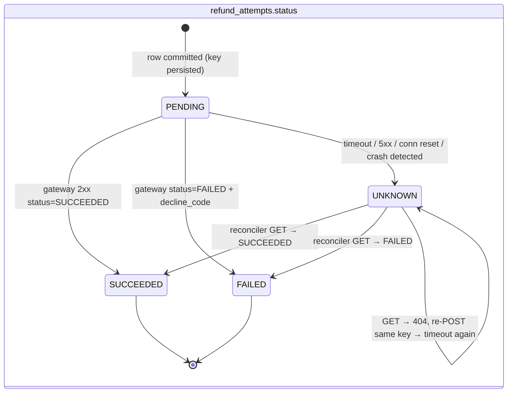
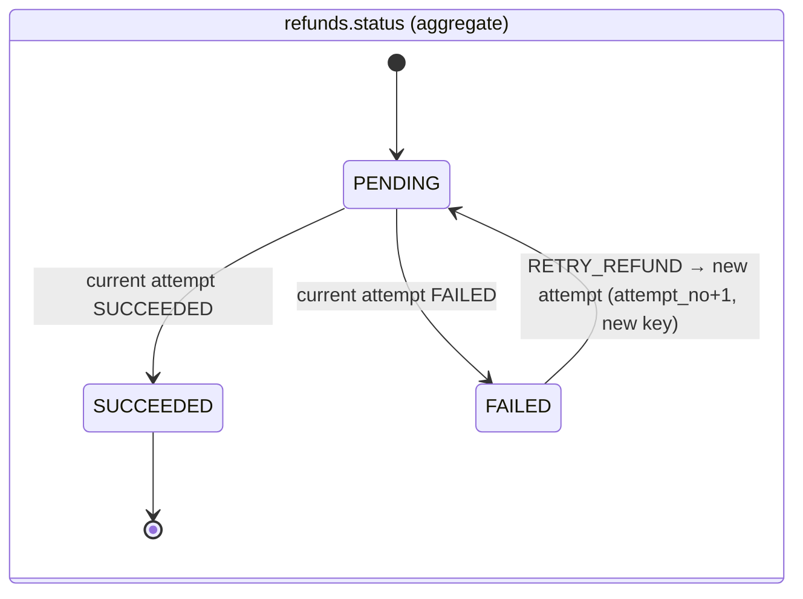

# ADR-001: Refund idempotency

- **Status:** Proposed (2026-11-20)
- **Deciders:** ReturnRight team
- **Related:** [Architecture Part 1](../architecture/01-architecture-part1.md) §4 (state machine), §5 (F-01 to F-10), §6 (BR-11 to BR-16), §7 (ledger)

## Context

The brief says refunds **must be idempotent**: a double click, or a retry after a timeout, must never pay twice. Finance has already paid duplicate refunds in the current spreadsheet process, so this is the headline requirement.

Duplicate payouts can come from four distinct sources, and each needs its own defence:

1. **The client repeats a request**: a double click, a browser retry, or a user re-submitting after a spinner.
2. **Concurrent actors**: two finance reviewers, or the request thread and the reconciler, act on the same return.
3. **An ambiguous outcome from the gateway**: a timeout, a 5xx, a dropped response, or a crash between our commit and the call. We do not know whether money moved.
4. **Logic or data bugs**: code that creates a second refund row for the same items.

Constraints: one Postgres, one app process (possibly several Uvicorn workers), a separate mock gateway that we control and can make flaky on purpose, and a hackathon timeline.

## Options

### (a) Client-supplied idempotency key only

The SPA sends `Idempotency-Key: <uuid>` on the mutating request. The server stores `(scope, key) → response` and replays it.

- ✅ Handles source 1 cleanly; this is the industry-standard API pattern.
- ❌ Does nothing for source 2 (two reviewers have two different keys).
- ❌ Does nothing for source 3: the key protects *our* API, not the *gateway* call. After a timeout we still don't know whether the gateway paid.
- ❌ Does nothing for source 4: a buggy code path ignores keys. The guarantee depends on every client behaving well.

### (b) Unique refund per return item, enforced by a DB constraint

`refund_items.return_item_id UNIQUE` (and `refunds.return_id UNIQUE`). A second refund for the same unit fails at INSERT.

- ✅ Handles sources 2 and 4 absolutely, whatever the code path. This is the strongest guarantee *inside our DB*.
- ✅ Survives a client that sends no key at all.
- ❌ Gives a poor UX for source 1: the second click gets a constraint error instead of the original success response.
- ❌ **Does nothing for source 3.** The DB row exists exactly once, but if we call the gateway twice for that one row (retry after a timeout), we pay twice. The DB cannot see the external side effect.

### (c) Both, plus the idempotency key passed through to the gateway (chosen)

The defences are layered, one per source:

| Layer | Mechanism | Stops |
|---|---|---|
| L1 HTTP | `Idempotency-Key` header required on `POST …/finance/…/approve`, `…/refund/retry`, `POST /returns`; stored in `idempotency_keys(scope,key)` with `request_hash` | Source 1: replays return the original response; same key + different body gives `422 IDEMPOTENCY_KEY_REUSED`; in-flight gives `409 REQUEST_IN_PROGRESS` |
| L2 State machine | `SELECT … FOR UPDATE` on `returns` + transition table; `If-Match` version | Source 2: the second approver sees `REFUND_PENDING` and gets `409 ILLEGAL_TRANSITION` |
| L3 DB uniqueness | `refunds.return_id UNIQUE`, `refund_items.return_item_id UNIQUE`, `finance_reviews.return_id UNIQUE`, `uq_refund_one_live_attempt` (≤1 attempt in PENDING/UNKNOWN/SUCCEEDED per refund) | Sources 2 and 4: the last line of defence inside our system |
| L4 Gateway pass-through | Each `refund_attempts` row gets a deterministic `gateway_idempotency_key = 'rr-{refund_id}-{attempt_no}'`, **persisted before the call**. Every POST and retry for that attempt reuses it. The gateway dedupes on it. | Source 3: re-sending is always safe, so "retry" means "ask again with the same key", never "pay again" |
| L5 Ledger uniqueness | `ledger_transactions.refund_attempt_id UNIQUE`; `finalize_attempt()` locks the attempt and is a no-op if it is already terminal | A double finalize (request thread vs reconciler) |
| L6 Reconciler | Background job resolves `UNKNOWN` and stale `PENDING` via `GET /v1/refunds/{key}`, or a re-POST with the same key | Source 3 recovery without humans |

- ✅ Covers all four sources. Each layer is simple and testable on its own.
- ❌ More moving parts: an `idempotency_keys` table, a `refund_attempts` table, and a reconciler loop. Roughly 1–1.5 days of work, which is the riskiest slice and therefore built first.
- ❌ The gateway must honour keys. We own the mock, so this is guaranteed. Real gateways (Razorpay, Stripe) offer the same.

## Decision

**Adopt (c).** The governing rules:

1. **A refund is created once per return; money moves once per attempt; attempts are serialized.** A new attempt (new gateway key) may be created **only** when every previous attempt is `FAILED`, meaning a *definitive* decline from the gateway. The DB enforces this with `uq_refund_one_live_attempt`.
2. **Write intent before acting.** The attempt row (`PENDING`, with its key) is committed **before** the gateway call. The gateway is never called with a key that is not in our DB.
3. **Ambiguity is `UNKNOWN`, never `FAILED`.** A timeout, 5xx, connection reset or malformed response becomes `UNKNOWN`. Only `{"status":"FAILED","decline_code":…}` becomes `FAILED`.
4. **Humans never retry `UNKNOWN`.** Finance sees "Refund status unknown: checking with gateway" and a **Recheck** button that runs the reconciler for that attempt (same key). The **Retry** button exists only in `REFUND_FAILED`.
5. **The amount is frozen** on `refunds.amount_paise` at creation and sent on every call for that attempt. The gateway rejects a key reused with a different amount.
6. **Ledger posting happens only on `SUCCEEDED`**, at most once per attempt, in the same transaction that moves the return to `REFUNDED`.
7. Store credit follows rules 1, 5 and 6 but has no gateway call. Its attempt goes `PENDING → SUCCEEDED` within a single transaction.

### Client idempotency key details (L1)

- The SPA generates a UUIDv4 **when the confirm dialog opens** (not per click) and sends it on every resend from that dialog.
- `scope = "{actor_id}:{METHOD} {route_template}"`, `request_hash = sha256(canonical JSON body + path params)`.
- Flow: `INSERT … ON CONFLICT DO NOTHING` with status `IN_PROGRESS`, **in the same transaction as the business change**. On conflict, read the row: if `COMPLETED` with the same hash, replay the stored status and body with the header `Idempotent-Replayed: true`. If `IN_PROGRESS`, return `409 REQUEST_IN_PROGRESS` with `Retry-After: 1`. If the hash differs, return `422 IDEMPOTENCY_KEY_REUSED`.
- The row is marked `COMPLETED` with the final response at the end of the request. A rollback (validation error) removes the key, so the client can fix the problem and retry with the same key.
- TTL is 24 h, cleaned up hourly.

## Refund status lifecycles





`UNKNOWN` attempts keep the refund `PENDING` and the return `REFUND_PENDING`. After **24 h** in `UNKNOWN` the attempt stays `UNKNOWN` (we never guess), `rr_refund_attempts_unknown_age_seconds` crosses the alert threshold, and Ops follows the runbook (manual check on the gateway admin API).

## Sequence: happy path, timeout + retry, lost response

```mermaid
sequenceDiagram
    autonumber
    actor FR as Finance Reviewer (SPA)
    participant API as FastAPI app
    participant DB as PostgreSQL
    participant GW as Mock Gateway
    participant REC as Reconciler (bg loop)

    rect rgba(120,180,120,0.12)
    Note over FR,GW: A. Happy path
    FR->>API: POST /api/v1/finance/returns/{id}/approve<br/>Idempotency-Key: K1, If-Match: "7"
    API->>DB: BEGIN
    API->>DB: INSERT idempotency_keys(scope,K1,IN_PROGRESS)
    API->>DB: SELECT returns WHERE id FOR UPDATE (status=PENDING_FINANCE, version=7 ✓)
    API->>DB: INSERT finance_reviews, refunds(amount=550050,PENDING),<br/>refund_items, refund_attempts(#1, key=rr-R-1, PENDING)
    API->>DB: UPDATE returns → REFUND_PENDING (v8) + audit_log rows
    API->>DB: COMMIT
    API->>DB: UPDATE refund_attempts SET request_sent_at=now (autocommit)
    API->>GW: POST /v1/refunds  Idempotency-Key: rr-R-1<br/>{payment_reference, amount_paise:550050}
    GW-->>API: 201 {status: SUCCEEDED, gateway_refund_id: gw_9f3}
    API->>DB: BEGIN; SELECT refund_attempts FOR UPDATE (PENDING)
    API->>DB: attempt→SUCCEEDED, refund→SUCCEEDED,<br/>INSERT ledger_transactions(refund_attempt_id UNIQUE)+entries,<br/>items→REFUNDED, returns→REFUNDED (v9), audit_log
    API->>DB: UPDATE idempotency_keys K1 → COMPLETED + response
    API->>DB: COMMIT
    API-->>FR: 200 {return_status: REFUNDED, refund_status: SUCCEEDED}
    FR->>API: (double click) POST …/approve Idempotency-Key: K1
    API->>DB: idempotency_keys K1 COMPLETED, same hash
    API-->>FR: 200 (replayed) Idempotent-Replayed: true
    end

    rect rgba(230,180,90,0.14)
    Note over FR,REC: B. Gateway timeout, then retry
    FR->>API: POST …/approve Idempotency-Key: K2
    API->>DB: (same txn as A.3–A.8) commit attempt #1 key=rr-R-1 PENDING
    API->>GW: POST /v1/refunds Idempotency-Key: rr-R-1
    Note right of GW: injected latency 8s > client timeout 3s.<br/>Gateway may or may not have processed it.
    GW--xAPI: no response within 3s (httpx ReadTimeout)
    API->>DB: attempt→UNKNOWN (return stays REFUND_PENDING), K2 COMPLETED
    API-->>FR: 202 {refund_status: UNKNOWN, message: "Checking with gateway"}
    FR->>API: Clicks Approve again (new dialog, key K3)
    API->>DB: SELECT returns FOR UPDATE → status REFUND_PENDING
    API-->>FR: 409 ILLEGAL_TRANSITION (no new attempt possible)
    REC->>DB: SELECT attempts WHERE status IN (UNKNOWN, stale PENDING)<br/>FOR UPDATE SKIP LOCKED
    REC->>GW: GET /v1/refunds/rr-R-1
    alt gateway never processed it
        GW-->>REC: 404 NOT_FOUND
        REC->>GW: POST /v1/refunds Idempotency-Key: rr-R-1 (same key, same amount)
        GW-->>REC: 201 {status: SUCCEEDED}
    else gateway processed it
        GW-->>REC: 200 {status: SUCCEEDED}
    end
    REC->>DB: finalize_attempt(): attempt→SUCCEEDED, ledger, return→REFUNDED
    end

    rect rgba(200,120,120,0.12)
    Note over API,REC: C. Gateway success, response lost
    API->>GW: POST /v1/refunds Idempotency-Key: rr-R-1
    GW->>GW: store key, status SUCCEEDED, gw_77a (money moved)
    GW--xAPI: response dropped (FAULT_DROP_RESPONSE_RATE)
    API->>DB: attempt→UNKNOWN
    REC->>GW: GET /v1/refunds/rr-R-1
    GW-->>REC: 200 {status: SUCCEEDED, gateway_refund_id: gw_77a}
    REC->>DB: BEGIN; SELECT attempt FOR UPDATE (UNKNOWN)
    REC->>DB: attempt→SUCCEEDED, ledger posted once, return→REFUNDED; COMMIT
    Note over REC,GW: Even if REC had re-POSTed, the gateway would replay gw_77a.<br/>Exactly one payout.
    end
```

## Reconciliation job for UNKNOWN / stale PENDING

- **Runner:** an `asyncio` loop started in the FastAPI lifespan, every **15 s**, guarded by `pg_try_advisory_lock(hashtext('rr_refund_reconciler'))` so only one worker runs it.
- **Selection:**
  ```sql
  SELECT id FROM refund_attempts
  WHERE method = 'ORIGINAL_PAYMENT'
    AND (status = 'UNKNOWN'
         OR (status = 'PENDING' AND created_at < now() - interval '60 seconds'))
    AND (last_checked_at IS NULL OR last_checked_at < now() - make_interval(secs => LEAST(300, 15 * 2 ^ LEAST(check_count, 5))))
  ORDER BY created_at
  LIMIT 20
  FOR UPDATE SKIP LOCKED;
  ```
  The backoff is 15 s, 30 s, 60 s and so on, capped at 5 min.
- **Per attempt:**
  1. `GET /v1/refunds/{key}`.
     - `SUCCEEDED` → `finalize_attempt(SUCCEEDED)` (ledger + `REFUND_SUCCEEDED` event).
     - `FAILED` → `finalize_attempt(FAILED)` (`REFUND_FAILED` event).
     - `PROCESSING` → leave it and bump `check_count`.
     - `404` → **re-POST with the same key and the same frozen amount**, then handle the result as above. A timeout or 5xx means it stays `UNKNOWN`.
  2. Update `last_checked_at` and `check_count`, and write an audit row `RECONCILE_CHECK` with the outcome.
- **Finance "Recheck" button** (`POST /api/v1/finance/refund-attempts/{id}/recheck`) runs the same function synchronously for one attempt.
- **Metrics:** `rr_reconciler_runs_total{result}`, `rr_refund_attempts_unknown` (gauge), `rr_refund_attempts_unknown_oldest_age_seconds` (gauge, alert at > 900 s).
- **Daily three-way check:** checks R1–R5 in Architecture §7.5 catch anything the per-attempt loop missed (e.g. a gateway refund with no matching attempt would indicate a bug or a manual payout).

## Consequences

**Positive**
- A double click, concurrent reviewers, a timeout, a lost response, or a crash at any point leaves **at most one payout and at most one ledger posting** per return, and each guarantee is backed by a DB constraint, not only by code.
- The guarantees can be tested in isolation: unit tests for the state-machine table, DB tests for constraint violations, and integration tests against the gateway with fault injection (`latency`, `drop_response`, `error_rate`). Locust can hammer `/approve` with duplicated keys and assert `count(gateway refunds) == count(returns REFUNDED)`.
- The SRE "break the gateway" demo shows UNKNOWN → reconciled → REFUNDED live on the dashboard.

**Negative / costs**
- Extra tables (`idempotency_keys`, `refund_attempts`) plus a background loop to build and test first.
- Returns can sit in `REFUND_PENDING` for up to a few minutes while the gateway is degraded. The customer sees "Processing", which is correct but slower than a naive retry.
- Some liveness is given up for safety: a gateway that never answers leaves an attempt `UNKNOWN` indefinitely and needs a human with the runbook. That is the right trade-off for money.
- Multiple Uvicorn workers rely on Postgres row locks and advisory locks. There is no in-memory state, which also makes the app safe to restart mid-demo.

**Follow-ups**
- ADR-002 (proposed): background execution vs synchronous gateway call. We are synchronous for now ([A-27]).
- The gateway contract (deliverable 12) must implement: key + amount mismatch → 422, `GET /v1/refunds/{key}`, `GET /v1/refunds?since=`.
