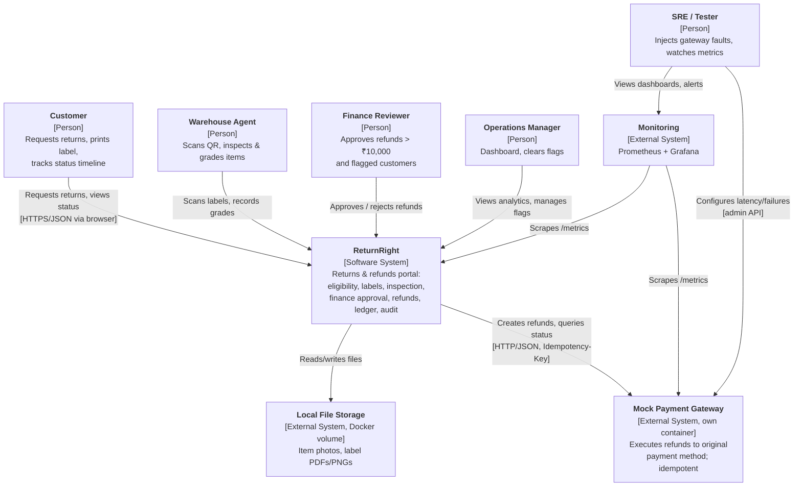
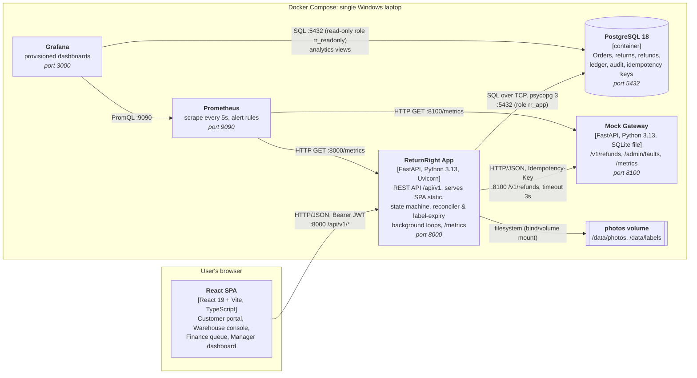
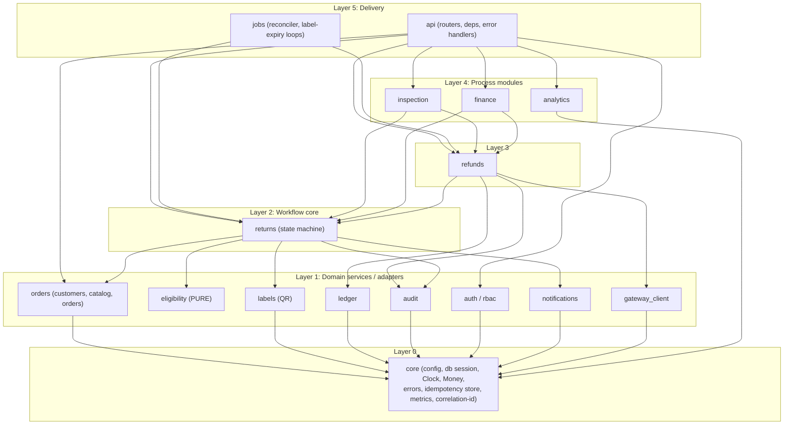
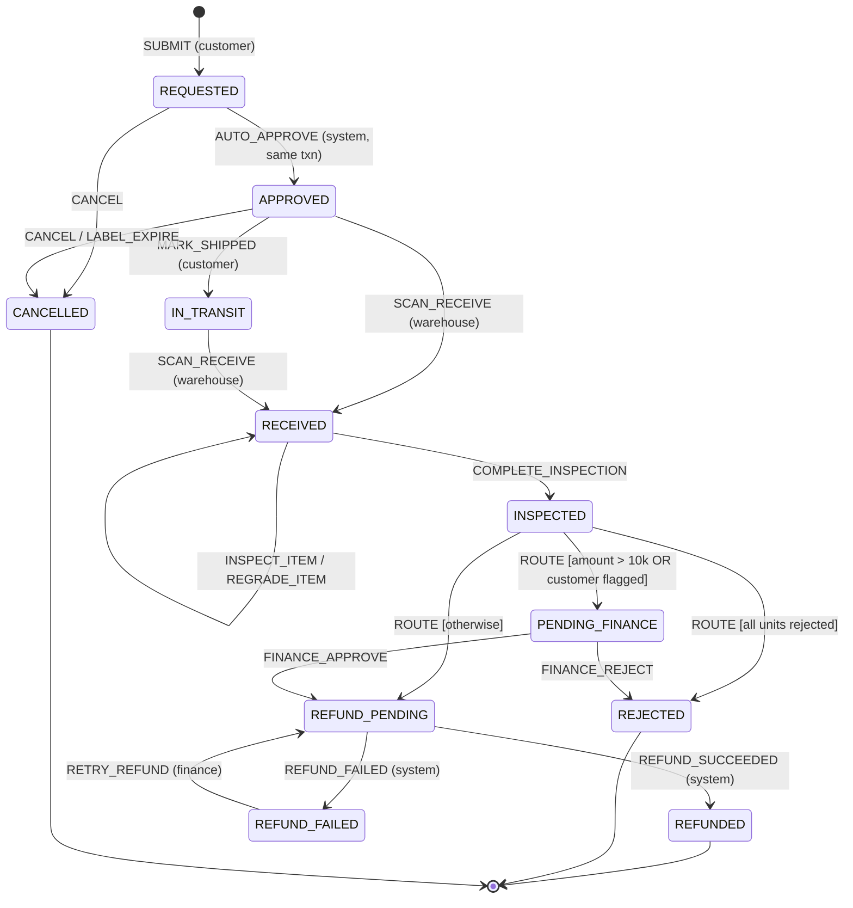
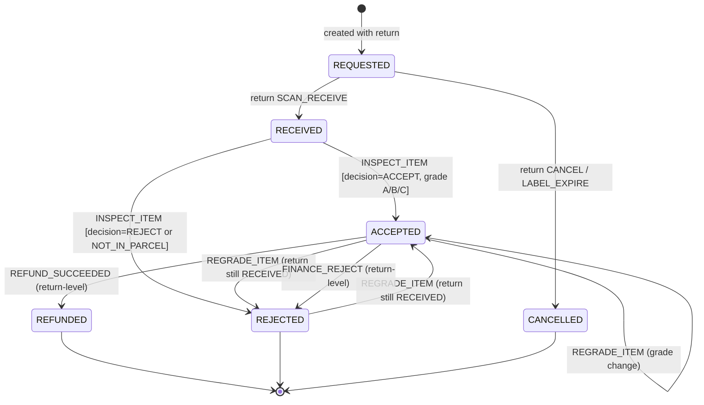
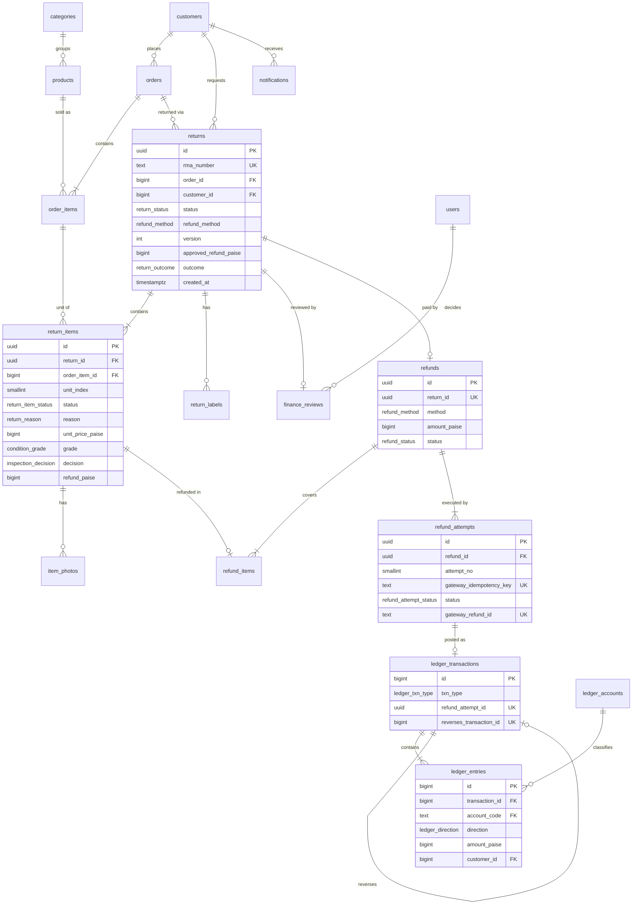

# ReturnRight — Architecture, Part 1 (Assumptions + Deliverables 1–8)

> **Implementation stack:** Java 21 + Spring Boot 4.1 (see [ADR-002](../adr/ADR-002-java-spring-stack-and-platform-services.md)). Python/FastAPI library names below are design-time placeholders; ADR-002 gives the Spring equivalent. The domain rules are unchanged.

> Status: **Draft v0.1** · Phase: Architecture (no application code) · Date: 2026-11-20
> Deliverable 8 (ADR-001) is in [../adr/ADR-001-refund-idempotency.md](../adr/ADR-001-refund-idempotency.md).

**Conventions used throughout**

- Money is stored as **integer paise** (`BIGINT`, columns end in `_paise`). There are no floats anywhere. ₹10,000.00 = `1_000_000` paise.
- Timestamps are `timestamptz` stored in UTC. The **business timezone is `Asia/Kolkata` (IST)**, and every calendar-day rule is evaluated in IST.
- Assumptions are tagged **[A-nn]**. To override one, edit its row and grep the tag. Code comments and tests should cite the tag.
- "System" is an internal actor (`actor_type='SYSTEM'`) used for automatic transitions (auto-approve, routing, reconciler, label expiry).

---

## 0. Ambiguities and recommended assumptions

| ID | Question | Options | **Recommended assumption** | Why |
|---|---|---|---|---|
| A-01 | Is the window counted from the order date or the delivery date? | order date · ship date · delivery date | **Delivery date** (`orders.delivered_at`). Orders that are not `DELIVERED` cannot be returned (`ORDER_NOT_DELIVERED`). | A customer cannot return something they have not received. Counting from the order date punishes slow delivery. The seed data must therefore set `delivered_at`. |
| A-02 | What happens on day 30 vs day 31? Which timezone? Inclusive or exclusive? | elapsed 720 h · calendar days UTC · calendar days IST | **Calendar days in IST, inclusive.** `days_since_delivery = request_date_IST − delivery_date_IST`. Eligible if `days_since_delivery ≤ window_days`. Example: delivered 2026-10-01 (any time IST), so day 30 = 2026-10-31 is eligible until 23:59:59 IST and 2026-11-01 is rejected. For electronics, 2026-10-11 is day 10 (OK) and 2026-10-12 is day 11 (rejected). | Calendar days match how customers read "30 days". IST avoids the 05:30 offset bug where UTC dates roll over at 05:30 local time. |
| A-03 | Which "now" counts? | page load · submit · server or client clock | **Server clock at submit**, provided by an injected `Clock`. The UI pre-check is advisory only. | Deterministic, testable and tamper-proof. |
| A-04 | Does state live at the return level, the item level, or both? | return only · item only · both | **Both.** The `returns` header holds the workflow state. Each `return_items` row holds its physical/financial outcome. Return transitions have guards that read item states. | Inspection outcomes are per item, but finance, refund and the timeline are per return. |
| A-05 | What is an "item": an order line with a quantity, or a physical unit? | line + qty · unit | **One `return_items` row per physical unit.** Returning 2 of a qty-3 line creates 2 rows (`unit_index` 1, 2). | Grades are physical, one per unit. This makes uniqueness ("a unit is refunded once") a plain DB constraint. |
| A-06 | Mixed basket (some items eligible, some not)? | create a partial return · reject the whole request | The UI shows eligibility per unit, and **only eligible units can be selected**. The backend re-validates, and **if any submitted unit is ineligible it rejects the whole request** (`422` with reasons per item). | The request is atomic, so no half-created returns exist. The customer still sees exactly why each item is excluded. |
| A-07 | Can there be several returns per order? | one · many | **Many**, but **each unit can be in at most one non-cancelled return** (partial unique index). | Customers return items at different times. Duplicates are blocked at the DB level. |
| A-08 | Is approval manual or automatic? | manual agent step · auto | **Automatic** when eligibility passes. `REQUESTED → APPROVED` happens in the same transaction, both audited, and the label is issued. | No persona in the brief owns manual approval. The timeline still shows both steps. |
| A-09 | What does "partial accept" mean? | (a) item accepted with an ad-hoc deduction % · (b) some units accepted and some rejected | **(b).** Each unit gets `decision ∈ {ACCEPT, REJECT}` plus a `grade`. "Partial accept" is a **derived return outcome** (`outcome='PARTIAL'`) when there is at least one ACCEPT and at least one REJECT. | Option (a) would stack an arbitrary % on top of the grade-C rule and make refunds non-deterministic. |
| A-10 | Grade factors and rounding? | — | **A = 100 %, B = 100 %, C = 50 %**, REJECT = 0. Half rounds up to the paise: `refund = (price + 1) / 2` (integer division) for C. | B is not specified, so we keep it generous. One rounding rule that can be enforced in a DB CHECK. |
| A-11 | What is the refund base? | list price · net paid · + shipping | **The net unit price actually paid** (`order_items.unit_price_paise`, after discount, including tax). **Shipping is not refunded.** | We can never refund more than was paid. |
| A-12 | Does the ₹10,000 finance threshold apply per item or per return? Before or after grade adjustment? | item/return × pre/post | **Per return, after grade adjustment, strictly greater than ₹10,000.00.** Exactly ₹10,000.00 is auto-refunded. | The amount actually at risk is what finance should see. Known gap: someone could split returns to stay under the threshold, but the flag rule (A-14) catches repeated splitting. |
| A-13 | Does a flag block the return or only mark it? | block · review | **Review only.** The return proceeds normally, but **every return of a flagged customer is routed to finance review regardless of amount**. The flag is read **live at routing time**. | The brief says "flagged for review". Reading it live covers customers who become flagged mid-flight. |
| A-14 | Does "more than 3 returns in 30 days" count requests or completed returns? | requests · completed · refunded | **Return requests created** (`returns.created_at`) in a **rolling 30×24 h window ending now**, **including** cancelled and rejected ones and **excluding** eligibility-refused attempts (no row is created for those). The flag is set on the **4th** request. | Completion lags by weeks. Request behaviour is the abuse signal. |
| A-15 | Can a flag be cleared? | auto-expire · manual | **Manual only**: the Ops Manager clears it with a mandatory note, which is audited. | Simple and accountable. |
| A-16 | Does store credit go through the gateway? | gateway · ledger only | **Ledger only.** It completes instantly with no gateway call. It still creates `refunds` and `refund_attempts` rows (`method='STORE_CREDIT'`), so the same uniqueness rules apply. | Store credit is an internal liability. The gateway only moves money externally. |
| A-17 | Who picks the refund method? | customer · finance | **The customer**, at request time (default `ORIGINAL_PAYMENT`). Finance may switch to `STORE_CREDIT` only after a `REFUND_FAILED`. | This matches "original method or store credit". |
| A-18 | Can a customer cancel? | any time · before shipping | **Yes, in `REQUESTED` or `APPROVED` only.** Not after `IN_TRANSIT`, because the parcel is with the carrier. | Prevents a race with a warehouse receipt. |
| A-19 | Does a label expire? | never · N days | **It expires 14 days after issue.** An hourly job moves `APPROVED` returns with expired labels to `CANCELLED` (`cancel_reason='LABEL_EXPIRED'`) and frees the units. They can be re-requested only if they are still inside the window. | Stops returns sitting open forever. |
| A-20 | What happens when an item is rejected after inspection? | refund 0 · return to customer | **No refund. `disposition='RETURN_TO_CUSTOMER'`** (recorded only, no logistics). If **all** units are rejected, the return ends `REJECTED`. | Keeps the money path clean. Shipping logistics are out of scope. |
| A-21 | Can finance reject? | no · yes | **Yes**, from `PENDING_FINANCE` with a reason code. The return goes to `REJECTED`. | Needed for fraud review of flagged customers. |
| A-22 | What happens on a definitive gateway decline? | auto-retry · manual | The return goes to **`REFUND_FAILED`**. Finance retries (a new attempt) or switches to store credit. **`UNKNOWN` is never retried by a human, only reconciled.** | A human retry on `UNKNOWN` is exactly how double payments happen. |
| A-23 | Payment methods? | incl. COD | Seed **`CARD`, `UPI`, `NETBANKING`, `WALLET` only, with no COD**. | COD has no "original method" to refund to. Avoids a whole sub-flow. |
| A-24 | How does a customer identify themselves? | accounts · order# + email | **Order number + email** (case-insensitive) returns a short-lived customer token **scoped to that `customer_id`**, so the customer can see all their orders. | Hackathon-appropriate. Detailed in deliverable 11. |
| A-25 | Are photos required? | required · optional | **Optional** for customers (reasons `DAMAGED`/`DEFECTIVE`) and for inspection. Max 5 MB each, JPEG/PNG only, stored on a Docker volume. | It is demoable without making photos a blocker. |
| A-26 | How are notifications sent? | email · in-app | A **`notifications` table** shown in the portal, plus a structured log line. No SMTP. | Free, offline, demoable. |
| A-27 | Is the gateway call sync or async? | sync after commit · queue | **Synchronous, after the DB commit, with a 3 s timeout.** A background reconciler covers crashes and timeouts. | There is no queue infrastructure, and this is deterministic for tests. |
| A-28 | Currency? | — | **INR only.** | Brief. |
| A-29 | Do successful customer logins count toward the per-order lookup limit? | count all · count failures only | **Failures only.** 10 failed lookups per order number per hour lock that order's lookup for the rest of the hour. Successful lookups never count. The per-IP limit (5/min) still counts every attempt. *(Team decision, 2026-11-20.)* | The limit exists to stop email guessing. Counting successes locked real customers out after 10 logins in an hour. |

---

## 1. C4 Level 1: System Context



---

## 2. C4 Level 2: Containers

Decision: the **React SPA is built into static files and served by the FastAPI container** (multi-stage Dockerfile). This keeps the Compose services exactly as specified (app, db, mock gateway, Prometheus, Grafana). During development, Vite (`:5173`) proxies `/api` to `:8000`.



Notes:

- The gateway keeps its own state in its own store (SQLite in its container), so it is a genuinely separate system. It cannot cheat by reading our DB, and reconciliation is real.
- Postgres roles: `rr_migrator` (Alembic, owns the schema) creates `rr_app` (DML only, **no UPDATE/DELETE on ledger and audit tables**) and `rr_readonly` (Grafana).
- Test tools (pytest, Playwright, Locust) run on the host against the published ports.

---

## 3. Backend module breakdown

Modular monolith layout: `backend/app/modules/<name>/` each contain `models.py`, `service.py`, `schemas.py`, and an optional `router.py`. **Rule: a module may import only from modules in a lower layer.** An `import-linter` contract in CI enforces this.



| Module | Owns tables | Responsibilities | May depend on |
|---|---|---|---|
| `core` | `idempotency_keys` | Settings, SQLAlchemy engine/session (one transaction per request), `Clock` protocol (`SystemClock`, `FixedClock`), `Money` helpers (paise, half-up), `AppError` → error envelope, idempotency middleware helpers, Prometheus registry, correlation-ID context var | — |
| `auth` | `users` | Staff login (seeded users), customer lookup by order# + email, JWT issue/verify, `require_role(...)` dependency, ownership checks | core |
| `orders` | `customers`, `categories`, `products`, `orders`, `order_items` | Read models for orders/units; "returnable units" query (units not in an active return); customer flag field + flag/clear operations | core |
| `eligibility` | — (pure) | `evaluate(EligibilityInput, now) -> EligibilityResult`. **No DB, no I/O, no imports outside stdlib + its own dataclasses.** | nothing (not even `core`) |
| `labels` | `return_labels` | Issue a label (RMA, tracking no., random `qr_token`, QR PNG via `segno`), void, expire, resolve a token to a return | core |
| `audit` | `audit_log` | `audit.record(session, ...)`: appends in the **caller's transaction**. Never commits on its own. | core |
| `notifications` | `notifications` | Writes customer-visible notification rows (same transaction) | core |
| `ledger` | `ledger_accounts`, `ledger_transactions`, `ledger_entries` | `post(session, LedgerPosting)` checks the balance and appends; `reverse(txn_id)`; balance queries; reconciliation queries. Has no UPDATE path. | core |
| `gateway_client` | — | `httpx` client: `create_refund(key, ...)`, `get_refund(key)`. Maps timeouts and 5xx to `GatewayOutcome.UNKNOWN`. Gateway latency histogram. | core |
| `returns` | `returns`, `return_items`, `item_photos` | **The single transition function**, transition table, guards, routing policy (finance threshold, flag), flag evaluation on submit, create return (calls eligibility + labels), cancel, timeline projection | orders, eligibility, labels, audit, notifications, core |
| `refunds` | `refunds`, `refund_items`, `refund_attempts` | Create refund + attempt; execute gateway call after commit; `finalize_attempt()` (idempotent); store-credit path; reconcile UNKNOWN/stale PENDING; fire `REFUND_SUCCEEDED/FAILED` events into `returns` | returns, ledger, gateway_client, audit, core |
| `inspection` | (writes `return_items` via `returns` API) | Scan QR → `SCAN_RECEIVE`; grade/decide units; `COMPLETE_INSPECTION`; triggers `refunds.initiate` when routing results in `REFUND_PENDING` | returns, refunds |
| `finance` | `finance_reviews` | Review queue, approve/reject, retry failed refund, switch to store credit, manual "recheck" of UNKNOWN (calls reconciler for that attempt) | returns, refunds |
| `analytics` | SQL views | Read-only queries/views for the dashboard. Imports no other domain module (SQL only). | core |
| `api` / `jobs` | — | HTTP wiring, background loops (`asyncio` tasks guarded by `pg_try_advisory_lock` so only one runner) | everything above |

How the cycle is avoided: `returns` never calls `refunds`. The callers (`inspection`, `finance`) run the transition, and if the new state is `REFUND_PENDING` they call `refunds.initiate()` in the same transaction. `refunds` reports back by calling `returns.apply_event()`. Dependencies always point downward.

---

## 4. Return state machine

### 4.1 Return (header) states



`INSPECTED` is persisted and audited, but `ROUTE` always fires **in the same transaction**, so no return rests in `INSPECTED`. It exists so that the audit trail and timeline record the moment inspection finished.

### 4.2 Return item (unit) states



Item transitions are **driven only by return-level events** inside the same transition function. The single exception is `INSPECT_ITEM`/`REGRADE_ITEM`, which goes through the same function, locks the parent return row, and requires the parent to be `RECEIVED`.

### 4.3 Transition table

Roles: **C** = Customer (must own the return), **W** = Warehouse Agent, **F** = Finance Reviewer, **M** = Ops Manager, **S** = System.
Every row writes **one `audit_log` row per changed entity** (the return and each item) in the same transaction. That is not repeated in each row below.

| # | From | Event | To | Role | Guards (failure → error code) | Side effects (same txn unless marked *post-commit*) |
|---|---|---|---|---|---|---|
| T1 | ∅ | `SUBMIT` | `REQUESTED` | C | All units are eligible by the engine (`ITEM_NOT_ELIGIBLE` + per-item reasons); ≥1 unit (`EMPTY_RETURN`); units not in an active return (`UNIT_ALREADY_IN_RETURN`, also enforced by the DB); order belongs to the caller (`FORBIDDEN`) | Insert `returns` + `return_items` (with `eligibility_snapshot`, `unit_price_paise` snapshot); **evaluate the flag rule** (count > 3 sets `customers.is_flagged`, audit `CUSTOMER_FLAGGED`); metric `rr_returns_requested_total` |
| T2 | `REQUESTED` | `AUTO_APPROVE` | `APPROVED` | S | Fires immediately after T1 in the same txn | `labels.issue()` (`return_labels` ACTIVE, expires +14 d, QR PNG written to the volume **post-commit**; regenerated on demand if missing); notification `RETURN_APPROVED` |
| T3 | `APPROVED` | `MARK_SHIPPED` | `IN_TRANSIT` | C | Label `ACTIVE` and not expired (`LABEL_EXPIRED`) | notification `IN_TRANSIT` |
| T4 | `APPROVED`, `IN_TRANSIT` | `SCAN_RECEIVE` | `RECEIVED` | W | `qr_token` resolves to this return (`LABEL_NOT_FOUND`); label `ACTIVE` (`LABEL_VOID`/`LABEL_EXPIRED`) | Label to `USED`; all `REQUESTED` items to `RECEIVED`; notification `RECEIVED`. **The same scan in `RECEIVED` or later returns 200 `already_received=true` with no transition** (see F-06). |
| T5 | `REQUESTED`, `APPROVED` | `CANCEL` | `CANCELLED` | C, M | Not yet scanned | Label to `VOIDED`; items to `CANCELLED` (frees units); `cancel_reason='CUSTOMER'`; notification |
| T6 | `APPROVED` | `LABEL_EXPIRE` | `CANCELLED` | S | `label.expires_at < now` | Same as T5 with `cancel_reason='LABEL_EXPIRED'` |
| T7 | `RECEIVED` | `INSPECT_ITEM` | `RECEIVED` | W | Item in `RECEIVED`; ACCEPT requires `grade`; REJECT requires `reject_reason` (`VALIDATION_ERROR`) | Item to `ACCEPTED`/`REJECTED`; set `grade`, `decision`, `refund_paise` (C = half-up 50 %, REJECT = 0), `inspected_by`, `inspected_at` |
| T8 | `RECEIVED` | `REGRADE_ITEM` | `RECEIVED` | W | Item `ACCEPTED`/`REJECTED`, return still `RECEIVED` | Recompute the item's `refund_paise` |
| T9 | `RECEIVED` | `COMPLETE_INSPECTION` | `INSPECTED` | W | No item left in `RECEIVED` (`INSPECTION_INCOMPLETE`) | `approved_refund_paise = Σ item.refund_paise`; `outcome ∈ {FULL, PARTIAL, NONE}`; **then ROUTE (T10–T12) in the same txn** |
| T10 | `INSPECTED` | `ROUTE` | `REJECTED` | S | `approved_refund_paise = 0` | notification `REJECTED` (with item reasons) |
| T11 | `INSPECTED` | `ROUTE` | `PENDING_FINANCE` | S | `approved_refund_paise > 1_000_000` **or** `customers.is_flagged` (read live, `FOR SHARE`) | `requires_finance_review=true`, `finance_review_reason ∈ {AMOUNT, FLAGGED, BOTH}`; metric |
| T12 | `INSPECTED` | `ROUTE` | `REFUND_PENDING` | S | Otherwise | `refunds.initiate()`: insert `refunds`, `refund_items`, `refund_attempts`(#1, `PENDING`). **Gateway call is post-commit** (ORIGINAL), or for STORE_CREDIT a ledger posting followed by T15 in the same txn. |
| T13 | `PENDING_FINANCE` | `FINANCE_APPROVE` | `REFUND_PENDING` | F | `Idempotency-Key` header required; `If-Match` version matches (`STALE_VERSION`); `finance_reviews` UNIQUE(return_id) | Insert `finance_reviews(APPROVED)`; `refunds.initiate()` as in T12 |
| T14 | `PENDING_FINANCE` | `FINANCE_REJECT` | `REJECTED` | F | Reason required; `If-Match` | Insert `finance_reviews(REJECTED)`; ACCEPTED items to `REJECTED` (`reject_reason='FINANCE_REJECTED'`); notification |
| T15 | `REFUND_PENDING` | `REFUND_SUCCEEDED` | `REFUNDED` | S | Refund attempt is `SUCCEEDED` (by `finalize_attempt`) | **Ledger posting** (UNIQUE per attempt); ACCEPTED items to `REFUNDED`; `refunds.status=SUCCEEDED`; notification `REFUNDED`; `closed_at`; metric |
| T16 | `REFUND_PENDING` | `REFUND_FAILED` | `REFUND_FAILED` | S | Attempt `FAILED` (definitive gateway decline) | `refunds.status=FAILED`; notification to finance queue; metric |
| T17 | `REFUND_FAILED` | `RETRY_REFUND` | `REFUND_PENDING` | F | `Idempotency-Key`; no attempt in `PENDING/UNKNOWN/SUCCEEDED` (also enforced by the DB); optional `method=STORE_CREDIT` | New `refund_attempts` row (`attempt_no+1`, new gateway key); `refunds.status=PENDING` |

Not a transition: an attempt becoming **`UNKNOWN`** leaves the return in `REFUND_PENDING`. Only the reconciler (or a finance "recheck", which runs the same reconciler code) resolves it.

### 4.4 Customer-facing timeline mapping

| Internal return state | Timeline step shown | Extra customer copy |
|---|---|---|
| `REQUESTED` | Requested | — |
| `APPROVED` | Approved | "Print your label. It's valid until {expires_at:dd MMM}." |
| `IN_TRANSIT` | In transit | — |
| `RECEIVED` | Received | "We're inspecting your items." |
| `INSPECTED`, `PENDING_FINANCE` | Inspected | "Your refund of ₹X is being reviewed." (we never reveal "flagged") |
| `REFUND_PENDING`, `REFUND_FAILED` | Inspected | "Your refund of ₹X is being processed." (a failure is shown as processing; finance handles it) |
| `REFUNDED` | Refunded | "₹X refunded to {method}." Partial: "N of M items refunded. See details." |
| `REJECTED` | Rejected | Per-item reason microcopy |
| `CANCELLED` | Cancelled *(extra terminal step not in the brief)* | "Cancelled by you" or "Label expired" |

The timestamp for each step is the **first `audit_log` row whose `to_state` maps to that step**. There is no separate history table to drift out of sync.

### 4.5 How illegal transitions are rejected

1. **There is one entry point**: `returns.service.apply_event(session, return_id, event, actor, *, expected_version=None, payload=None) -> Return`. No other code may assign `Return.status` or `ReturnItem.status`. A unit test greps the codebase for `.status =` outside `returns/state_machine.py`.
2. **The transition table is data**: `TRANSITIONS: dict[tuple[ReturnStatus, ReturnEvent], Transition(to, roles, guards, effects)]`. A missing key raises `IllegalTransition`, which becomes **`409 ILLEGAL_TRANSITION`** with `{current_state, event}` in the details.
3. **Concurrency is handled by a pessimistic row lock plus a version check.** `apply_event` starts with `SELECT … FROM returns WHERE id=:id FOR UPDATE`, which serialises concurrent events on one return so the second caller sees the new state and gets a 409. `returns.version` (int, +1 per transition) is returned to clients as an `ETag`. Human mutating calls send `If-Match: <version>`, and a mismatch gives **`409 STALE_VERSION`** ("someone else changed this return, reload"). *Trade-off:* the lock alone would be enough for correctness. The version adds stale-screen detection for two humans looking at the same return, at the cost of one header.
4. **Role and ownership checks** (`403 FORBIDDEN_ROLE`) run before guards. Guards return a reason code (`422 GUARD_FAILED:<code>`).
5. **DB safety net**: trigger `trg_returns_valid_transition` (BEFORE UPDATE OF status) rejects any `(OLD.status, NEW.status)` pair that is not in the allowed set. A test asserts that the SQL set equals the Python table, which catches raw-SQL scripts and seed bugs.
6. **Effects are split**: DB effects (items, label, ledger, audit, notifications, refund rows) run in the **same transaction**. External effects (gateway call, QR file write) run **post-commit**, from a list collected on the unit of work, so a rollback can never leave behind an external call that "already happened" without a record. The pending `refund_attempts` row is committed before the call (see ADR-001).

---

## 5. Failure-mode analysis (state machine and money path)

| # | Failure mode | Trigger | Impact if unmitigated | Detection | Mitigation |
|---|---|---|---|---|---|
| F-01 | **Double-clicked refund approval** | Finance clicks Approve twice (same or new request) | Two refunds paid | `idempotency_keys` hit; `409` counter `rr_http_conflicts_total{code}` | The SPA disables the button and generates **one `Idempotency-Key` per dialog open**. Same key: a replay returns the stored response, or `409 REQUEST_IN_PROGRESS` while it is running. Different key: the `FOR UPDATE` lock means the second call sees `REFUND_PENDING` and gets `409 ILLEGAL_TRANSITION`. Backstops: `finance_reviews` UNIQUE(return_id), `refunds` UNIQUE(return_id), `refund_items` UNIQUE(return_item_id). |
| F-02 | **Gateway timeout, then retry** | Gateway is slow (fault injection) and httpx times out after 3 s | The retry pays again; or a retry with a *new* key pays twice | `rr_gateway_requests_total{outcome="timeout"}`; attempt `UNKNOWN` | The attempt is marked **`UNKNOWN`** and the return stays `REFUND_PENDING`. **Humans cannot create a new attempt while one is UNKNOWN** (partial unique index). The reconciler calls `GET /v1/refunds/{key}`, and on 404 **re-POSTs with the same key**. The gateway dedupes on the key. |
| F-03 | **Gateway succeeded, response lost** | Gateway commits and the response is dropped (`FAULT_DROP_RESPONSE_RATE`) | We think it failed and pay again; or the ledger never records a real payout | Attempt `UNKNOWN`; reconciliation mismatch metric | The same path as F-02. The `GET` returns `SUCCEEDED` and `finalize_attempt()` posts the ledger and moves the return to `REFUNDED`. Re-POSTing the same key returns the original result (`Idempotent-Replayed: true`). |
| F-04 | **Two finance reviewers approve at once** | Two tabs or two people | Double refund, or contradictory approve and reject | One request gets 409 | Row lock serialises them, the loser gets `409 ILLEGAL_TRANSITION` or `STALE_VERSION`. `finance_reviews` UNIQUE(return_id) is the final DB backstop. |
| F-05 | **Warehouse scans a cancelled or already-inspected return** | An old label is printed and the parcel arrives anyway | Cancelled return resurrected; inspection overwritten | `409` with a specific code; counter | A scan in `CANCELLED` gives `409 RETURN_CANCELLED`, and the UI says "Do not accept: return cancelled. Send back to customer." A scan in `INSPECTED` or later gives 200 `already_received=true` plus the current state (read-only). A voided label gives `LABEL_VOID`. |
| F-06 | **QR scanned twice** | Double scan or scanner bounce | Duplicate audit rows; error noise for agents | — | `SCAN_RECEIVE` is **idempotent by design**: if the state is already `RECEIVED`, return 200 with no transition and no audit row. The label is `USED` after the first scan. |
| F-07 | **Crash between DB commit and gateway call** | App killed after T12/T13 commit | Refund stuck forever; or a "fix" re-sends with a new key | Attempt `PENDING` with `request_sent_at IS NULL` older than 60 s; `rr_refund_attempts_stuck` gauge | The reconciler picks stale `PENDING` attempts (`FOR UPDATE SKIP LOCKED`). `GET` gives 404, so it POSTs with **the same key**. Keys are derived from DB rows, never from memory. |
| F-08 | **Crash after gateway success, before finalize** | App dies after the 201 response | Paid, but not in the ledger and the return not marked REFUNDED | Attempt stays `PENDING` after the request was sent | The same reconciler path: `GET` returns `SUCCEEDED`, so it finalizes. `finalize_attempt` is idempotent (locks the attempt; a no-op if already terminal). Ledger UNIQUE(refund_attempt_id) prevents a double posting. |
| F-09 | **Reconciler and request thread finalize concurrently** | A slow response arrives just as the reconciler runs | Double ledger posting | UNIQUE violation logged | `SELECT … FROM refund_attempts … FOR UPDATE` in `finalize_attempt`. The second caller sees a terminal status and does nothing. Ledger UNIQUE backstop. |
| F-10 | **Gateway idempotency key reused with a different payload** | Bug: amount changed between retries | Gateway refuses; or worse, pays a stale amount | Gateway `422 IDEMPOTENCY_KEY_MISMATCH`; alert | The amount is frozen on `refunds.amount_paise` when the refund is created and never changes. A mismatch leaves the attempt `UNKNOWN` and fires the alert `RefundReconciliationStuck`. A human investigates. |
| F-11 | **Clock or timezone boundary** | Request at 00:10 IST on day 31 (= 18:40 UTC the previous day) | Wrongly eligible or wrongly ineligible | Unit tests at boundaries | Day arithmetic only in IST dates (A-02). Injected `Clock`. Tests cover 23:59:59 and 00:00:00 IST on day 30/31 and 10/11, plus UTC midnight. The DB trigger uses the same IST conversion (`AT TIME ZONE 'Asia/Kolkata'`). |
| F-12 | **Clock skew between app and DB** | Container clocks differ | Eligibility (app now) disagrees with the trigger (DB `returns.created_at`) | Trigger rejection | `returns.created_at` is **set by the app from the same `Clock` value** used for eligibility (not `DEFAULT now()`). The trigger checks against `NEW.created_at`, so both use one timestamp. |
| F-13 | **Seed data violates the rules** | The generator writes a return for innerwear, or day 45, or a refund > price | The demo shows impossible data; analytics are wrong | Seed fails loudly | Historical returns are seeded **through the service layer** (`apply_event` with `FixedClock`), never raw INSERTs into `returns`. DB CHECKs and triggers (section 6.3) reject anything else. A post-seed `validate_seed.py` asserts the invariants (ledger balanced, no unit in two returns, flags consistent with counts). |
| F-14 | **Flagged customer submits mid-review** | Customer has 3 open returns and submits a 4th | The 4th is flagged but the earlier 3 auto-refund | `CUSTOMER_FLAGGED` audit row | The flag is set in the T1 txn (with a `FOR UPDATE` on the customer row, so concurrent submits count correctly). Routing (T11) reads the flag **live**, so any of the customer's returns not yet routed go to finance. Already `REFUND_PENDING`/`REFUNDED` returns are not clawed back. They are shown on the manager's flagged-customers panel. |
| F-15 | **Concurrent submits for the same unit** | Two tabs submit returns for the same unit | Unit returned twice | UNIQUE violation, mapped to `409 UNIT_ALREADY_IN_RETURN` | Partial unique index `uq_return_items_active_unit (order_item_id, unit_index) WHERE status <> 'CANCELLED'`. |
| F-16 | **Label expires while the parcel is in the carrier network** | Customer ships on day 13 without clicking "shipped"; the expiry job cancels on day 14 | Parcel arrives for a cancelled return | `RETURN_CANCELLED` on scan | Only `APPROVED` (not `IN_TRANSIT`) expires. If the scan hits `CANCELLED`, the agent is told to send it back. *Accepted risk for the hackathon*; an Ops "reinstate" action is listed under cuts. |
| F-17 | **Customer cancels while the warehouse is scanning** | Race between T5 and T4 | Inconsistent label/items | One request gets 409 | Row lock serialises them. Whichever commits first wins, and the other gets `409 ILLEGAL_TRANSITION`. |
| F-18 | **Ledger row edited or deleted** | A developer "fixes" data by hand | Books no longer reconcile | DB error | `rr_app` has no UPDATE/DELETE grant. Trigger `trg_ledger_immutable` raises on UPDATE/DELETE for every role. Corrections are made only with reversal transactions. |
| F-19 | **Gateway returns 5xx (not a timeout)** | Fault injection `FAULT_ERROR_RATE` | Treating it as failed leads to a duplicate on retry | Counter | 5xx and connection reset are treated as `UNKNOWN` (we can't know whether it was processed). Only an explicit `status: FAILED` with a `decline_code` is `FAILED`. |
| F-20 | **Store-credit refund partially applied** | Exception after ledger insert | Credit without a REFUNDED return, or the reverse | — | The store-credit path is **one DB transaction** (attempt SUCCEEDED, ledger, T15). It all commits or none of it does. |

---

## 6. Data model

### 6.1 ERD



(`audit_log`, `idempotency_keys` and `users` are standalone. `audit_log` uses a polymorphic `entity_type`/`entity_id` on purpose and has no FKs, so it can never block a write.)

### 6.2 Enums

```sql
CREATE TYPE order_status          AS ENUM ('PLACED','SHIPPED','DELIVERED','CANCELLED');
CREATE TYPE payment_method        AS ENUM ('CARD','UPI','NETBANKING','WALLET');                 -- [A-23]
CREATE TYPE staff_role            AS ENUM ('WAREHOUSE_AGENT','FINANCE_REVIEWER','OPS_MANAGER');
CREATE TYPE return_status         AS ENUM ('REQUESTED','APPROVED','IN_TRANSIT','RECEIVED','INSPECTED',
                                           'PENDING_FINANCE','REFUND_PENDING','REFUND_FAILED',
                                           'REFUNDED','REJECTED','CANCELLED');
CREATE TYPE return_item_status    AS ENUM ('REQUESTED','RECEIVED','ACCEPTED','REJECTED','REFUNDED','CANCELLED');
CREATE TYPE return_reason         AS ENUM ('DAMAGED','DEFECTIVE','WRONG_ITEM','SIZE_FIT',
                                           'NOT_AS_DESCRIBED','CHANGED_MIND','LATE_DELIVERY','OTHER');
CREATE TYPE return_outcome        AS ENUM ('FULL','PARTIAL','NONE');                             -- [A-09]
CREATE TYPE condition_grade       AS ENUM ('A','B','C');
CREATE TYPE inspection_decision   AS ENUM ('ACCEPT','REJECT');
CREATE TYPE reject_reason         AS ENUM ('NOT_IN_PARCEL','WRONG_ITEM_RETURNED','USED_OR_DAMAGED_BY_CUSTOMER',
                                           'MISSING_PARTS','FINANCE_REJECTED');
CREATE TYPE cancel_reason         AS ENUM ('CUSTOMER','LABEL_EXPIRED','OPS');
CREATE TYPE label_status          AS ENUM ('ACTIVE','USED','VOIDED','EXPIRED');
CREATE TYPE finance_decision      AS ENUM ('APPROVED','REJECTED');
CREATE TYPE finance_review_reason AS ENUM ('AMOUNT','FLAGGED','BOTH');
CREATE TYPE refund_method         AS ENUM ('ORIGINAL_PAYMENT','STORE_CREDIT');
CREATE TYPE refund_status         AS ENUM ('PENDING','SUCCEEDED','FAILED');
CREATE TYPE refund_attempt_status AS ENUM ('PENDING','SUCCEEDED','FAILED','UNKNOWN');
CREATE TYPE ledger_direction      AS ENUM ('DEBIT','CREDIT');
CREATE TYPE ledger_txn_type       AS ENUM ('REFUND_ORIGINAL','REFUND_STORE_CREDIT','REVERSAL');
CREATE TYPE actor_type            AS ENUM ('CUSTOMER','STAFF','SYSTEM');
CREATE TYPE photo_kind            AS ENUM ('CUSTOMER','INSPECTION');
```

### 6.3 Tables (DDL sketch; Alembic is the source of truth once written)

`[BR-x]` marks a constraint that **enforces a business rule in the database**.

```sql
-- ---------- Reference & orders ----------
CREATE TABLE categories (
  id                 smallint PRIMARY KEY,
  code               text NOT NULL UNIQUE,              -- ELECTRONICS, APPAREL, FOOTWEAR, HOME_KITCHEN, INNERWEAR, PERISHABLES
  name               text NOT NULL,
  is_returnable      boolean NOT NULL,
  return_window_days smallint,
  CONSTRAINT ck_categories_window CHECK (                -- [BR-1] non-returnable ⇔ no window; windows sane
      (NOT is_returnable AND return_window_days IS NULL)
   OR (is_returnable AND return_window_days BETWEEN 1 AND 365))
);
-- Seeded: ELECTRONICS 10, APPAREL 30, FOOTWEAR 30, HOME_KITCHEN 30, INNERWEAR (not returnable), PERISHABLES (not returnable)

CREATE TABLE products (
  id           bigint GENERATED ALWAYS AS IDENTITY PRIMARY KEY,
  sku          text NOT NULL UNIQUE,
  name         text NOT NULL,
  category_id  smallint NOT NULL REFERENCES categories(id),
  price_paise  bigint NOT NULL CHECK (price_paise > 0)
);
CREATE INDEX ix_products_category ON products(category_id);

CREATE TABLE customers (
  id           bigint GENERATED ALWAYS AS IDENTITY PRIMARY KEY,
  email        text NOT NULL,
  full_name    text NOT NULL,
  phone        text,
  is_flagged   boolean NOT NULL DEFAULT false,
  flagged_at   timestamptz,
  flag_reason  text,
  created_at   timestamptz NOT NULL,
  CONSTRAINT ck_customers_flag CHECK (is_flagged = (flagged_at IS NOT NULL))
);
CREATE UNIQUE INDEX uq_customers_email_ci ON customers (lower(email));

CREATE TABLE orders (
  id                bigint GENERATED ALWAYS AS IDENTITY PRIMARY KEY,
  order_number      text NOT NULL UNIQUE,              -- e.g. RR-2026-000123
  customer_id       bigint NOT NULL REFERENCES customers(id),
  status            order_status NOT NULL,
  payment_method    payment_method NOT NULL,
  payment_reference text NOT NULL UNIQUE,              -- original gateway charge id (mock)
  placed_at         timestamptz NOT NULL,
  delivered_at      timestamptz,
  total_paise       bigint NOT NULL CHECK (total_paise > 0),
  CONSTRAINT ck_orders_delivered CHECK ((status = 'DELIVERED') = (delivered_at IS NOT NULL)),  -- [BR-2] A-01
  CONSTRAINT ck_orders_dates     CHECK (delivered_at IS NULL OR delivered_at >= placed_at)
);
CREATE INDEX ix_orders_customer ON orders(customer_id, placed_at DESC);

CREATE TABLE order_items (
  id               bigint GENERATED ALWAYS AS IDENTITY PRIMARY KEY,
  order_id         bigint NOT NULL REFERENCES orders(id),
  line_no          smallint NOT NULL,
  product_id       bigint NOT NULL REFERENCES products(id),
  quantity         smallint NOT NULL CHECK (quantity BETWEEN 1 AND 10),
  unit_price_paise bigint NOT NULL CHECK (unit_price_paise > 0),   -- net paid per unit [A-11]
  UNIQUE (order_id, line_no)
);

-- ---------- Staff ----------
CREATE TABLE users (
  id            bigint GENERATED ALWAYS AS IDENTITY PRIMARY KEY,
  username      text NOT NULL UNIQUE,
  display_name  text NOT NULL,
  password_hash text NOT NULL,                         -- argon2id
  role          staff_role NOT NULL,
  is_active     boolean NOT NULL DEFAULT true
);

-- ---------- Returns ----------
CREATE TABLE returns (
  id                     uuid PRIMARY KEY,             -- uuid7 generated in app
  rma_number             text NOT NULL UNIQUE,         -- RMA-26-000451
  order_id               bigint NOT NULL REFERENCES orders(id),
  customer_id            bigint NOT NULL REFERENCES customers(id),  -- denormalised for flag counting
  status                 return_status NOT NULL,
  refund_method          refund_method NOT NULL DEFAULT 'ORIGINAL_PAYMENT',
  version                integer NOT NULL DEFAULT 1,
  approved_refund_paise  bigint CHECK (approved_refund_paise >= 0),
  outcome                return_outcome,
  requires_finance_review boolean NOT NULL DEFAULT false,
  finance_review_reason  finance_review_reason,
  cancel_reason          cancel_reason,
  created_at             timestamptz NOT NULL,         -- set from app Clock (F-12)
  updated_at             timestamptz NOT NULL,
  closed_at              timestamptz,
  CONSTRAINT ck_returns_amount_after_inspection CHECK (   -- [BR-3] money only after inspection
      status IN ('REQUESTED','APPROVED','IN_TRANSIT','RECEIVED','CANCELLED')
      OR approved_refund_paise IS NOT NULL),
  CONSTRAINT ck_returns_refunded_positive CHECK (status <> 'REFUNDED' OR approved_refund_paise > 0),
  CONSTRAINT ck_returns_finance_threshold CHECK (         -- [BR-4] > ₹10,000 can't skip finance
      approved_refund_paise IS NULL OR approved_refund_paise <= 1000000 OR requires_finance_review),
  CONSTRAINT ck_returns_cancel_reason CHECK ((status = 'CANCELLED') = (cancel_reason IS NOT NULL)),
  CONSTRAINT ck_returns_terminal_closed CHECK (
      (status IN ('REFUNDED','REJECTED','CANCELLED')) = (closed_at IS NOT NULL))
);
CREATE INDEX ix_returns_customer_created ON returns(customer_id, created_at);  -- flag rule [BR-5]
CREATE INDEX ix_returns_status ON returns(status) WHERE closed_at IS NULL;      -- work queues
CREATE INDEX ix_returns_order ON returns(order_id);
-- Trigger trg_returns_valid_transition: BEFORE UPDATE OF status → allowed (OLD,NEW) pairs only  [BR-6]
-- Trigger trg_finance_approval_required: BEFORE UPDATE OF status when NEW.status='REFUND_PENDING' AND
--   NEW.requires_finance_review → EXISTS finance_reviews(return_id, decision='APPROVED')          [BR-4]

CREATE TABLE return_items (
  id                  uuid PRIMARY KEY,
  return_id           uuid NOT NULL REFERENCES returns(id),
  order_item_id       bigint NOT NULL REFERENCES order_items(id),
  unit_index          smallint NOT NULL CHECK (unit_index >= 1),
  status              return_item_status NOT NULL,
  reason              return_reason NOT NULL,
  reason_note         text CHECK (char_length(reason_note) <= 500),
  unit_price_paise    bigint NOT NULL CHECK (unit_price_paise > 0),   -- snapshot of order_items
  eligibility_snapshot jsonb NOT NULL,              -- engine output incl. window, day count, rule version
  grade               condition_grade,
  decision            inspection_decision,
  reject_reason       reject_reason,
  refund_paise        bigint,
  disposition         text CHECK (disposition IN ('RESTOCK','REFURBISH','RETURN_TO_CUSTOMER','DISPOSE')),
  inspected_by        bigint REFERENCES users(id),
  inspected_at        timestamptz,
  CONSTRAINT ck_ri_accept_needs_grade CHECK (decision <> 'ACCEPT' OR grade IS NOT NULL),
  CONSTRAINT ck_ri_reject_needs_reason CHECK (decision <> 'REJECT' OR reject_reason IS NOT NULL),
  CONSTRAINT ck_ri_grade_refund CHECK (                 -- [BR-7] grade C = 50 % (half-up), A/B = 100 %, reject = 0
      decision IS NULL AND refund_paise IS NULL
   OR decision = 'REJECT' AND refund_paise = 0
   OR decision = 'ACCEPT' AND refund_paise =
        CASE WHEN grade = 'C' THEN (unit_price_paise + 1) / 2 ELSE unit_price_paise END),
  CONSTRAINT ck_ri_status_decision CHECK (
      (status IN ('ACCEPTED','REFUNDED') AND decision = 'ACCEPT')
   OR (status = 'REJECTED' AND decision = 'REJECT')
   OR (status IN ('REQUESTED','RECEIVED','CANCELLED') AND decision IS NULL))
);
CREATE UNIQUE INDEX uq_return_items_active_unit                 -- [BR-8] a unit is in ≤1 live return
  ON return_items(order_item_id, unit_index) WHERE status <> 'CANCELLED';
CREATE INDEX ix_return_items_return ON return_items(return_id);
-- Trigger trg_return_item_eligibility (BEFORE INSERT)                                         [BR-9]
--   * unit_index <= order_items.quantity
--   * category.is_returnable (innerwear/perishables refused)
--   * order.status = 'DELIVERED' and the order belongs to returns.customer_id
--   * (returns.created_at AT TIME ZONE 'Asia/Kolkata')::date
--       - (orders.delivered_at AT TIME ZONE 'Asia/Kolkata')::date <= category.return_window_days

CREATE TABLE item_photos (
  id             uuid PRIMARY KEY,
  return_item_id uuid NOT NULL REFERENCES return_items(id),
  kind           photo_kind NOT NULL,
  storage_path   text NOT NULL UNIQUE,              -- relative to /data/photos
  content_type   text NOT NULL CHECK (content_type IN ('image/jpeg','image/png')),
  size_bytes     integer NOT NULL CHECK (size_bytes BETWEEN 1 AND 5242880),
  sha256         char(64) NOT NULL,
  uploaded_at    timestamptz NOT NULL
);

CREATE TABLE return_labels (
  id              uuid PRIMARY KEY,
  return_id       uuid NOT NULL REFERENCES returns(id),
  qr_token        text NOT NULL UNIQUE,              -- 26-char random (128-bit); QR encodes only this
  tracking_number text NOT NULL UNIQUE,              -- MOCKSHIP-XXXXXXXX
  status          label_status NOT NULL,
  issued_at       timestamptz NOT NULL,
  expires_at      timestamptz NOT NULL,
  used_at         timestamptz,
  CONSTRAINT ck_label_expiry CHECK (expires_at > issued_at),
  CONSTRAINT ck_label_used CHECK ((status = 'USED') = (used_at IS NOT NULL))
);
CREATE UNIQUE INDEX uq_label_one_active ON return_labels(return_id) WHERE status = 'ACTIVE';

-- ---------- Finance ----------
CREATE TABLE finance_reviews (
  id                   uuid PRIMARY KEY,
  return_id            uuid NOT NULL UNIQUE REFERENCES returns(id),  -- [BR-10] one decision per return
  reviewer_id          bigint NOT NULL REFERENCES users(id),
  decision             finance_decision NOT NULL,
  amount_paise_reviewed bigint NOT NULL CHECK (amount_paise_reviewed >= 0),
  note                 text,
  decided_at           timestamptz NOT NULL,
  CONSTRAINT ck_fr_reject_note CHECK (decision = 'APPROVED' OR note IS NOT NULL)
);

-- ---------- Refunds ----------
CREATE TABLE refunds (
  id            uuid PRIMARY KEY,
  return_id     uuid NOT NULL UNIQUE REFERENCES returns(id),  -- [BR-11] one refund per return
  customer_id   bigint NOT NULL REFERENCES customers(id),
  amount_paise  bigint NOT NULL CHECK (amount_paise > 0),     -- frozen at creation (F-10)
  status        refund_status NOT NULL,
  created_at    timestamptz NOT NULL,
  completed_at  timestamptz
);

CREATE TABLE refund_items (
  refund_id      uuid NOT NULL REFERENCES refunds(id),
  return_item_id uuid NOT NULL UNIQUE REFERENCES return_items(id),  -- [BR-12] a unit is refunded ≤ once
  amount_paise   bigint NOT NULL CHECK (amount_paise > 0),
  PRIMARY KEY (refund_id, return_item_id)
);
-- Deferred constraint trigger: Σ refund_items.amount_paise = refunds.amount_paise  [BR-13]

CREATE TABLE refund_attempts (
  id                      uuid PRIMARY KEY,
  refund_id               uuid NOT NULL REFERENCES refunds(id),
  attempt_no              smallint NOT NULL CHECK (attempt_no >= 1),
  method                  refund_method NOT NULL,
  gateway_idempotency_key text NOT NULL UNIQUE,      -- 'rr-{refund_id}-{attempt_no}'  [BR-14]
  status                  refund_attempt_status NOT NULL,
  gateway_refund_id       text UNIQUE,
  decline_code            text,
  created_at              timestamptz NOT NULL,
  request_sent_at         timestamptz,
  last_checked_at         timestamptz,
  check_count             integer NOT NULL DEFAULT 0,
  completed_at            timestamptz,
  UNIQUE (refund_id, attempt_no),
  CONSTRAINT ck_ra_store_credit_no_gateway CHECK (method = 'ORIGINAL_PAYMENT' OR gateway_refund_id IS NULL),
  CONSTRAINT ck_ra_failed_has_code CHECK (status <> 'FAILED' OR decline_code IS NOT NULL)
);
CREATE UNIQUE INDEX uq_refund_one_live_attempt                  -- [BR-15] no new attempt while one
  ON refund_attempts(refund_id)                                 -- is pending/unknown/succeeded
  WHERE status IN ('PENDING','UNKNOWN','SUCCEEDED');
CREATE INDEX ix_ra_reconcile ON refund_attempts(status, created_at)
  WHERE status IN ('PENDING','UNKNOWN');

-- ---------- Ledger (see §7) ----------
CREATE TABLE ledger_accounts (
  code        text PRIMARY KEY,
  name        text NOT NULL,
  normal_side ledger_direction NOT NULL
);
CREATE TABLE ledger_transactions (
  id                      bigint GENERATED ALWAYS AS IDENTITY PRIMARY KEY,
  txn_type                ledger_txn_type NOT NULL,
  return_id               uuid NOT NULL REFERENCES returns(id),
  refund_attempt_id       uuid UNIQUE REFERENCES refund_attempts(id),        -- [BR-16] post once per attempt
  reverses_transaction_id bigint UNIQUE REFERENCES ledger_transactions(id),  -- [BR-17] reverse at most once
  memo                    text NOT NULL,
  correlation_id          uuid NOT NULL,
  posted_at               timestamptz NOT NULL,
  posted_by_actor         text NOT NULL,
  CONSTRAINT ck_lt_shape CHECK (
      (txn_type = 'REVERSAL') = (reverses_transaction_id IS NOT NULL)
  AND (txn_type = 'REVERSAL' OR refund_attempt_id IS NOT NULL))
);
CREATE TABLE ledger_entries (
  id             bigint GENERATED ALWAYS AS IDENTITY PRIMARY KEY,
  transaction_id bigint NOT NULL REFERENCES ledger_transactions(id),
  account_code   text NOT NULL REFERENCES ledger_accounts(code),
  direction      ledger_direction NOT NULL,
  amount_paise   bigint NOT NULL CHECK (amount_paise > 0),
  customer_id    bigint REFERENCES customers(id),
  return_item_id uuid REFERENCES return_items(id),
  CONSTRAINT ck_le_store_credit_customer CHECK (account_code <> 'STORE_CREDIT_LIABILITY' OR customer_id IS NOT NULL)
);
CREATE INDEX ix_le_txn ON ledger_entries(transaction_id);
CREATE INDEX ix_le_account_customer ON ledger_entries(account_code, customer_id);
-- trg_ledger_balanced: CONSTRAINT TRIGGER ... DEFERRABLE INITIALLY DEFERRED → Σdebit = Σcredit per txn [BR-18]
-- trg_ledger_immutable: BEFORE UPDATE OR DELETE on both tables → RAISE                             [BR-19]
-- REVOKE UPDATE, DELETE, TRUNCATE ON ledger_* FROM rr_app;

-- ---------- Cross-cutting ----------
CREATE TABLE audit_log (
  id             bigint GENERATED ALWAYS AS IDENTITY PRIMARY KEY,
  occurred_at    timestamptz NOT NULL,
  correlation_id uuid NOT NULL,
  actor_type     actor_type NOT NULL,
  actor_id       text NOT NULL,                     -- user id, customer id, or 'system:reconciler'
  actor_role     text NOT NULL,
  entity_type    text NOT NULL,                     -- 'return','return_item','refund','refund_attempt','customer','label'
  entity_id      text NOT NULL,
  event          text NOT NULL,                     -- ReturnEvent name or e.g. CUSTOMER_FLAGGED
  from_state     text,
  to_state       text,
  before         jsonb,
  after          jsonb,
  metadata       jsonb NOT NULL DEFAULT '{}'
);
CREATE INDEX ix_audit_entity ON audit_log(entity_type, entity_id, occurred_at);
CREATE INDEX ix_audit_corr ON audit_log(correlation_id);
-- trg_audit_immutable + REVOKE UPDATE, DELETE → append-only                                       [BR-20]

CREATE TABLE idempotency_keys (
  scope           text NOT NULL,                    -- '{actor_id}:{METHOD} {route template}'
  key             text NOT NULL CHECK (char_length(key) BETWEEN 8 AND 128),
  request_hash    char(64) NOT NULL,                -- sha256 of canonical body + path params
  status          text NOT NULL CHECK (status IN ('IN_PROGRESS','COMPLETED')),
  response_status smallint,
  response_body   jsonb,
  created_at      timestamptz NOT NULL,
  expires_at      timestamptz NOT NULL,             -- +24h; cleanup job
  PRIMARY KEY (scope, key)
);

CREATE TABLE notifications (
  id          uuid PRIMARY KEY,
  customer_id bigint NOT NULL REFERENCES customers(id),
  return_id   uuid REFERENCES returns(id),
  template    text NOT NULL,
  payload     jsonb NOT NULL,
  created_at  timestamptz NOT NULL,
  read_at     timestamptz
);
CREATE INDEX ix_notifications_customer ON notifications(customer_id, created_at DESC);
```

### 6.4 Business rules enforced in the database

| Tag | Business rule | Enforced by |
|---|---|---|
| BR-1 | Innerwear and perishables are not returnable; electronics has 10 days, the rest 30 | `ck_categories_window` + seeded category rows |
| BR-2 | Only delivered orders have a delivery date | `ck_orders_delivered` |
| BR-3 | No refund amount before inspection | `ck_returns_amount_after_inspection` |
| BR-4 | Refunds above ₹10,000 need finance approval | `ck_returns_finance_threshold` + trigger `trg_finance_approval_required` |
| BR-5 | Flag rule (> 3 requests in 30 days) | **App** (count in the T1 txn with the customer row locked), supported by `ix_returns_customer_created`. Not a constraint, because it is a time-window rule. |
| BR-6 | Only legal state transitions | `trg_returns_valid_transition` |
| BR-7 | Grade C = 50 %, reject = 0, never more than paid | `ck_ri_grade_refund` |
| BR-8 | A unit cannot be in two live returns | `uq_return_items_active_unit` |
| BR-9 | Window and returnability (incl. day-30/31 boundary in IST) | `trg_return_item_eligibility` (mirrors the engine, so seed data cannot cheat) |
| BR-10 | One finance decision per return | `finance_reviews.return_id UNIQUE` |
| BR-11/12 | One refund per return; each unit refunded at most once | `refunds.return_id UNIQUE`, `refund_items.return_item_id UNIQUE` |
| BR-13 | Refund total = sum of its items | deferred constraint trigger |
| BR-14/15 | A gateway key is used for one attempt only; no parallel attempts | `refund_attempts.gateway_idempotency_key UNIQUE`, `uq_refund_one_live_attempt` |
| BR-16/17 | A successful attempt is posted to the ledger once; reversed at most once | `ledger_transactions` UNIQUE columns |
| BR-18 | Double entry balances | `trg_ledger_balanced` (deferred) |
| BR-19/20 | Ledger and audit are append-only | immutability triggers + `REVOKE` |

---

## 7. Ledger design

### 7.1 Decision: **lightweight double-entry**

| | Single-entry (one row per money movement) | **Double-entry (balanced debit/credit lines)** |
|---|---|---|
| Build cost | Lowest | +2 tables, 1 deferred trigger (~half a day) |
| Store-credit balance | Separate balance table, which can drift | `Σ credits − Σ debits` on `STORE_CREDIT_LIABILITY` per customer: derived, no drift |
| Grade-C deduction visibility | Lost (only the net amount is recorded) | Explicit `RETURN_CONDITION_RECOVERY` line |
| Self-check | None | Every transaction must balance, which catches bugs at commit time |
| Reconciliation with gateway | Possible | Easier: the `GATEWAY_SETTLEMENT` account total equals the gateway's ledger |

**Decision: double-entry.** It costs little extra code, gives us a provable invariant (balanced books) that the demo can show, and gives store credit its own balance without a mutable "balance" column. **Trade-off:** developers must think in debit/credit. We contain that with one `ledger.post()` API that accepts named posting templates, so developers never build raw entries.

### 7.2 Chart of accounts (seeded, fixed)

| `code` | Meaning | Normal side |
|---|---|---|
| `SALES_RETURNS` | Contra-revenue: gross value of accepted returned goods | DEBIT |
| `RETURN_CONDITION_RECOVERY` | Value kept because of condition (grade-C 50 %) | CREDIT |
| `GATEWAY_SETTLEMENT` | Cash paid out through the payment gateway | CREDIT (outflow) |
| `STORE_CREDIT_LIABILITY` | Store credit we owe customers (sub-ledger by `customer_id`) | CREDIT |

### 7.3 Posting templates

Example return: unit A (₹4,000, grade A, accept), unit B (₹3,001.00 = 300,100 paise, grade C, accept → 150,050), unit C (₹2,000, reject). Approved refund = 400,000 + 150,050 = **550,050 paise**.

**`REFUND_ORIGINAL`** is posted when an attempt reaches `SUCCEEDED`, never earlier:

| Account | Dr | Cr | `return_item_id` |
|---|---:|---:|---|
| SALES_RETURNS | 400,000 | | A |
| SALES_RETURNS | 300,100 | | B (gross) |
| RETURN_CONDITION_RECOVERY | | 150,050 | B (grade-C deduction) |
| GATEWAY_SETTLEMENT | | 550,050 | — |
| **Total** | **700,100** | **700,100** | |

Unit C (rejected) gets **no lines**. Nothing was refunded, so it does not belong in the ledger.

**`REFUND_STORE_CREDIT`** is the same, except the final credit is `STORE_CREDIT_LIABILITY` with `customer_id` set. A customer's balance = Σ CREDIT − Σ DEBIT on that account for that `customer_id`. Redeeming credit at checkout is out of scope, but it would be a DEBIT on that account.

**`REVERSAL`**: a new transaction that copies every line of the original with the **direction swapped**, sets `reverses_transaction_id` (UNIQUE, so it can only be reversed once), and carries a memo explaining why. Use it when reconciliation proves a posting was wrong (e.g. we posted SUCCEEDED but the gateway shows FAILED, which should never happen but must be fixable), or when finance converts a mistaken store-credit refund. **There is never an UPDATE or DELETE.** A correction = reversal + new correct posting.

When we **don't** post: `PENDING`, `UNKNOWN` and `FAILED` attempts. The ledger records only money that has actually moved. Pending exposure is visible from `refund_attempts`, not from the ledger. *Trade-off:* this means there is no accrual for "approved but not yet paid". That is acceptable for this scope and simpler to reconcile.

### 7.4 Immutability enforcement

1. `REVOKE UPDATE, DELETE, TRUNCATE ON ledger_transactions, ledger_entries FROM rr_app;`
2. `trg_ledger_immutable` (BEFORE UPDATE OR DELETE) raises an exception, which stops the migrator role and humans too.
3. `trg_ledger_balanced` is a deferred constraint trigger that checks `Σ DEBIT = Σ CREDIT` and `≥ 2 lines` for every touched transaction at COMMIT.
4. SQLAlchemy models for ledger tables expose no update methods. `ledger.post()` is the only writer.

### 7.5 Reconciliation (three-way)

The reconciliation job runs every 5 minutes and on demand at `POST /api/v1/ops/reconciliation/run`. It exports `rr_reconciliation_mismatches{check}`.

| Check | Query (sketch) | Expected |
|---|---|---|
| R1 Refund ↔ ledger | Every `refund_attempts.status='SUCCEEDED'` has exactly one `ledger_transactions` row with that `refund_attempt_id`, and its `GATEWAY_SETTLEMENT`/`STORE_CREDIT_LIABILITY` credit = `refunds.amount_paise`. Every non-reversal ledger txn has an attempt with status SUCCEEDED. | 0 rows in the anti-join |
| R2 Items ↔ ledger | Per return: Σ `SALES_RETURNS` debits − Σ `RETURN_CONDITION_RECOVERY` credits (net of reversals) = `returns.approved_refund_paise` for `REFUNDED` returns | equal |
| R3 Ledger ↔ gateway | `GET gateway /v1/refunds?since=…` (all SUCCEEDED refunds it holds) vs our SUCCEEDED `ORIGINAL_PAYMENT` attempts, joined on `idempotency_key`, comparing amount | No refunds that exist only on the gateway side (**that would be a double-pay or lost response**) and none only on ours |
| R4 Global balance | `SELECT SUM(CASE direction WHEN 'DEBIT' THEN amount_paise ELSE -amount_paise END) FROM ledger_entries` | 0 |
| R5 Stuck attempts | `PENDING/UNKNOWN` older than 15 min | 0, otherwise alert |

---

## 8. ADR-001: Refund idempotency

Full ADR: **[docs/adr/ADR-001-refund-idempotency.md](../adr/ADR-001-refund-idempotency.md)**

Summary: **Option (c). The client `Idempotency-Key` (HTTP layer), DB uniqueness per return and per unit (data layer), and a per-attempt key passed through to the gateway (external layer) are combined. A reconciler resolves `UNKNOWN`.**
